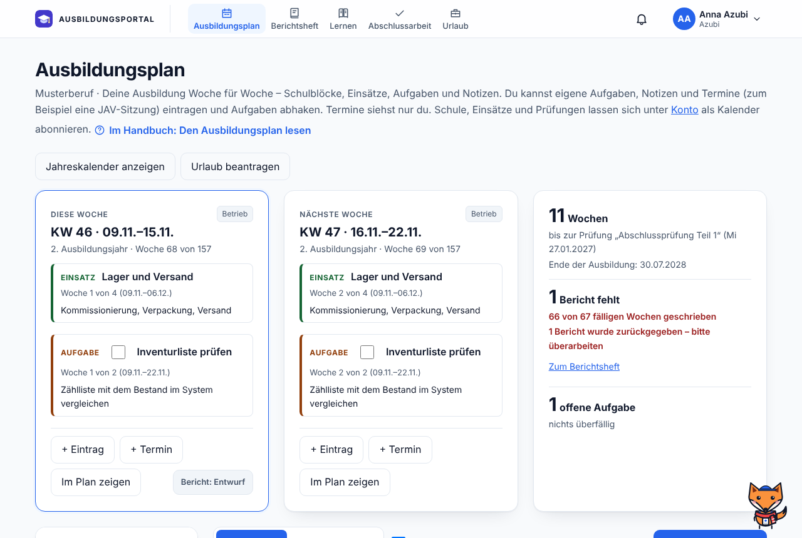
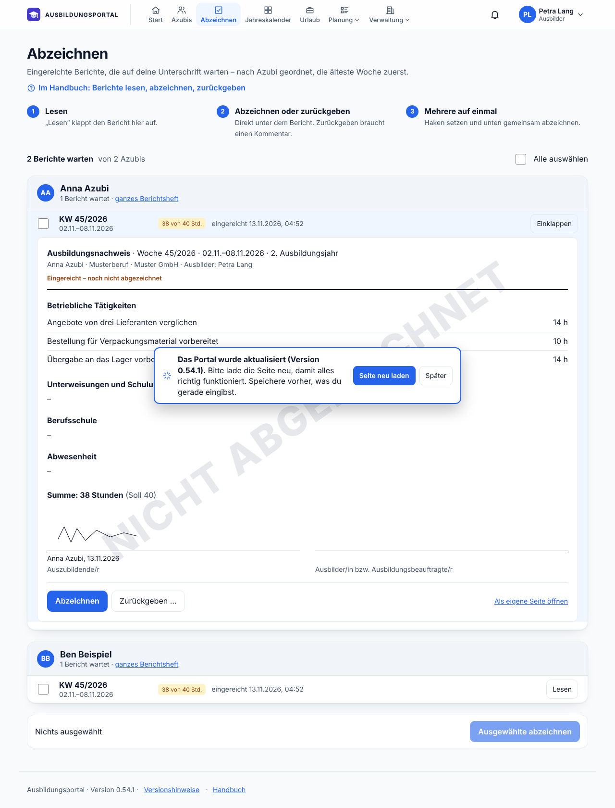
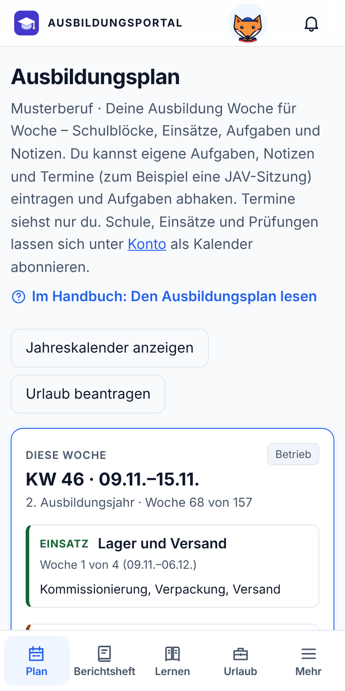

# Ausbildungsportal

Ausbildungsplan, Berichtsheft, Urlaub und Lernmodul für einen Ausbildungsbetrieb – mit Anmeldung und Rollen. Azubis, Ausbildungsbeauftragte und Ausbilder melden sich mit ihrem Microsoft-Konto (Entra ID) an; ein lokaler Super-Admin verwaltet die Konten.

**Stand: Version 0.70.1.** Fertig sind Anmeldung, Konten, Rechte und Protokoll, Stammdaten und Azubi-Profile, der Ausbildungsplan, das Berichtsheft mit Abzeichnen, Urlaub, das Lernmodul mit Planer für die Prüfung, Benachrichtigungen, ein Handbuch je Rolle und das Docker-Setup.

**So sieht es aus:** [Bildschirmfotos aller Bereiche](docs/bilder/README.md) – je Rolle, am PC und am Handy, mit erfundenen Beispieldaten.

| Ausbildungsplan der Azubis | Berichte abzeichnen | Am Handy |
| --- | --- | --- |
| [](docs/bilder/README.md) | [](docs/bilder/README.md) | [](docs/bilder/README.md) |

> **Frühe Version – noch nicht für den Echtbetrieb.** Die Anmeldung über Microsoft läuft in einer Installation gegen ein echtes Entra-Verzeichnis; die automatischen Tests nutzen einen nachgebildeten Anbieter. Eine unabhängige Sicherheitsprüfung gab es nicht. Wer die App einsetzt, tut das auf eigene Verantwortung (siehe [LICENSE](LICENSE)).

## Rollen

| Rolle | Anmeldung | Darf |
| --- | --- | --- |
| Super-Admin | lokal mit Passwort | Konten anlegen, sperren und löschen, das Protokoll einsehen, Fehler und Ideen fürs Portal bearbeiten, eingereichte Lerninhalte prüfen und hochladen, das Logo des Betriebs hinterlegen, den Begleiter der Azubis für das Portal ein- oder ausschalten – kein Zugriff auf Pläne, Berichte, Urlaub und Stammdaten |
| Ausbilder | Microsoft | **nur die eigenen Azubis** (im Profil als zuständig eingetragen) und Azubis ohne Ausbilder: Berichte abzeichnen, zurückgeben und eine Abzeichnung aufheben, Urlaub genehmigen, Ausbildungsplan und Profil pflegen, Beauftragte und Vertretungen zuweisen, Konten dieser Azubis und der Beauftragten anlegen, sperren und löschen; für alle: Stammdaten, Planbausteine, Sammelplanung, Lerninhalte ansehen und einreichen. Als **Vertretung** (Zuweisung mit Zeitraum) dieselben Rechte wie Beauftragte. Mit **Gesamtsicht** (setzt der Super-Admin) volle Rechte bei allen Azubis |
| Ausbildungsbeauftragte | Microsoft | nur zugewiesene Azubis sehen, Berichte für Wochen im Zeitraum der Zuweisung abzeichnen oder zurückgeben, Urlaub bestätigen, während der Zuweisung Aufgaben und Notizen im Plan anlegen, Lerninhalte ansehen |
| Azubi | Microsoft | nur die eigenen Daten; Berichte schreiben und einreichen, Urlaub beantragen, im Plan eigene Aufgaben, Notizen und Termine eintragen und Aufgaben abhaken, lernen – Lernstand, Planer und Begleiter sieht nur der Azubi selbst |

Rechte werden ausschließlich im Server geprüft (`server/rechte.ts`, `server/api.ts`); die Oberfläche blendet nur aus.

## Starten mit Docker

Voraussetzung: Docker mit Docker Compose ab Version 2.24.

```bash
cp .env.example .env      # APP_URL und die ENTRA_*-Werte eintragen
docker compose up -d --build
docker compose logs app   # beim ersten Start steht hier das Startpasswort des Super-Admins
```

- Die App lauscht danach auf `127.0.0.1:3000` – nur auf dem Server selbst. Davor gehört ein **Reverse Proxy mit HTTPS**; `APP_URL` in der `.env` ist die Adresse dieses Proxys, und `TRUST_PROXY=true` gehört dazu.
- **Andere Adresse oder anderer Port:** in der `.env` `BIND_ADRESSE` und `BIND_PORT` eintragen, z. B. `BIND_ADRESSE=100.64.0.10` und `BIND_PORT=8989`. Ohne Angabe gilt `127.0.0.1:3000`. Übernommen wird das mit `docker compose up -d` (nicht mit `restart`). Kontrolle: `docker compose config` zeigt, was gilt, `docker compose ps` den tatsächlich offenen Port – im Log der App steht immer Port 3000, das ist der Port im Container. `BIND_ADRESSE=0.0.0.0` öffnet die App in allen Netzen des Servers; das ist nur sinnvoll, wenn ein Reverse Proxy auf einem anderen Rechner oder eine Firewall davorsteht.
- Für mehr – mehrere Zuordnungen, gar keine Ports, eigene Netze – gibt es weiterhin eine eigene `docker-compose.override.yml` (Vorlage: `docker-compose.override.example.yml`).
- **`APP_URL` muss immer die Adresse sein, die im Browser steht.** Wer Adresse oder Port ändert und die App direkt aufruft, trägt genau diese Adresse ein, z. B. `APP_URL=http://100.64.0.10:8989`. Sonst lädt die Seite, aber Anmelden und Speichern werden abgelehnt.
- Ohne HTTPS funktioniert nur die lokale Anmeldung des Super-Admins. Microsoft nimmt als Umleitungs-URI nur `https://` an (Ausnahme `http://localhost`) – für die Microsoft-Anmeldung braucht es also den Reverse Proxy mit Zertifikat.
- Datenbank und Sicherungen liegen im Ordner `./data` neben der Compose-Datei und bleiben bei Updates und bei `docker compose down` erhalten.
- Die App läuft im Container als Benutzer mit der UID 1000, nicht als root. Die Rechte am Ordner `./data` richtet der Container beim Start selbst; nur wenn das nicht geht (z. B. Netzlaufwerk), von Hand: `sudo chown -R 1000:1000 ./data`.
- Nach einer Änderung an der `.env`: `docker compose up -d`. Update: `git pull`, dann `docker compose up -d --build`.

Zum Ausprobieren ohne Proxy und ohne `.env` reicht `docker compose up -d --build` und im Browser `http://localhost:3000` (nicht `127.0.0.1` – die Adresse muss zu `APP_URL` passen). Dann kann sich nur der Super-Admin anmelden.

## Starten ohne Docker

Voraussetzungen:

- Node.js ab 22.16 (nutzt das eingebaute `node:sqlite`)
- für die Microsoft-Anmeldung: eine App-Registrierung in Entra, siehe [docs/entra-einrichtung.md](docs/entra-einrichtung.md)

```bash
npm ci                    # genau die Versionen aus package-lock.json
cp .env.example .env      # APP_URL und später die ENTRA_*-Werte eintragen
npm run build             # Oberfläche nach dist/ bauen
npm start                 # Server auf Port 3000
```

Der Super-Admin meldet sich unter **`<Adresse>/super`** an (z. B. `https://ausbildung.example.de/super`); auf der normalen Anmeldeseite steht nur die Microsoft-Anmeldung. Das ist Übersichtlichkeit, kein Schutz – die Adresse ist nicht geheim, geschützt ist der Zugang durch Passwort und Sperre nach Fehlversuchen. Wie sich die Passwort-Anmeldung zusätzlich am Reverse Proxy auf das eigene Netz beschränken lässt, steht in [SECURITY.md](SECURITY.md#anmeldung-des-super-admins-am-reverse-proxy-schützen).

Beim **ersten Start** legt die App den Super-Admin an. Ohne `ADMIN_BENUTZER`/`ADMIN_PASSWORT` heißt er `admin`, und das Startpasswort steht einmalig in der Ausgabe. Bei der ersten Anmeldung muss es geändert werden (mindestens 14 Zeichen).

Danach als Super-Admin den ersten Ausbilder anlegen (Microsoft-Anmeldename + Rolle). Der Ausbilder legt Azubis und Beauftragte selbst an.

### Entwickeln

```bash
npm run dev               # baut die Oberfläche bei Änderungen neu und startet den Server neu
npm test                  # Tests (node:test)
npm run e2e               # Abläufe im Browser (Playwright; einmalig vorher: npx playwright install chromium)
npm run bilder            # Bildschirmfotos in docs/bilder/ neu erzeugen (erfundene Beispieldaten)
npm run typecheck
```

Mit `DEV_ANMELDUNG=true` in der `.env` kann man sich lokal ohne Entra als vorhandenes Konto anmelden. Die Einstellung wird in Produktion ignoriert.

## Konfiguration

Alle Einstellungen kommen aus Umgebungsvariablen (`.env`, Vorlage `.env.example`):

| Variable | Bedeutung |
| --- | --- |
| `APP_URL` | Adresse, unter der die Nutzer die App im Browser sehen. Bestimmt die Umleitungs-URI für Entra (`<APP_URL>/api/auth/entra/callback`) und ob Cookies nur über HTTPS gehen |
| `BIND_ADRESSE`, `BIND_PORT` | nur mit Docker: Adresse und Port, unter denen die App auf dem Server erreichbar ist (Standard `127.0.0.1` und `3000`) |
| `PORT`, `HOST` | nur ohne Docker: worauf der Server lauscht (Standard `3000`, `0.0.0.0`); mit Docker fest |
| `DATA_DIR` | Ordner für Datenbank und Sicherungen (Standard `./data`); mit Docker fest `/app/data` |
| `CONTENT_DIR` | Ordner mit gepflegten Inhalten wie den Schulferien (Standard `./content`); mit Docker fest `/app/content` |
| `LERN_DIR` | Ordner mit Lerninhalten für das Lernmodul, ein Unterordner je Inhaltspaket (Standard `./lerninhalte`); mit Docker fest `/app/lerninhalte` |
| `ENTRA_TENANT_ID`, `ENTRA_CLIENT_ID`, `ENTRA_CLIENT_SECRET` | App-Registrierung in Entra; ohne sie kann sich nur der Super-Admin anmelden |
| `ENTRA_PROFILBILD` | `true` holt bei der Anmeldung das Profilbild aus Microsoft 365; braucht die Berechtigung User.Read (siehe `docs/entra-einrichtung.md`). Standard: aus |
| `ADMIN_BENUTZER`, `ADMIN_PASSWORT` | nur für den ersten Start |
| `TRUST_PROXY` | `true` hinter einem Reverse Proxy (Client-IP aus `X-Forwarded-For`) |
| `FEHLER_WEBHOOK_URL` | freiwillig: Adresse eines Teams-Workflows, der bei jeder neuen Fehlermeldung und jeder neuen Idee fürs Portal benachrichtigt wird (siehe „Benachrichtigung in Teams“) |
| `FEHLER_WEBHOOK_MIT_TEXT` | `true` schickt auch den Text der Meldung nach Teams; Standard `false` |
| `TEAMS_CHAT_WEBHOOK_URL` | freiwillig: Adresse eines Teams-Workflows, der eine Nachricht als Chat an eine einzelne Person schickt (siehe „Benachrichtigungen per Teams und E-Mail“) |
| `SMTP_HOST`, `SMTP_ABSENDER` | freiwillig: Mailserver und Absender-Adresse für die Mail an die Personalstelle und für Benachrichtigungen per E-Mail (siehe „Mail an die Personalstelle“) |
| `SMTP_PORT`, `SMTP_SICHERHEIT` | Port und `starttls` (Vorgabe, Port 587), `tls` (Port 465) oder `keine` (Port 25, nur internes Relay ohne Anmeldung) |
| `SMTP_BENUTZER`, `SMTP_PASSWORT` | Anmeldung am Mailserver, falls er eine verlangt |
| `DEV_ANMELDUNG` | nur zum Entwickeln |


### Benachrichtigung in Teams

Freiwillig: Sobald jemand im Portal einen Fehler meldet, erscheint ein Hinweis in einem Teams-Kanal.

1. In Teams am gewünschten Kanal **… → Workflows** öffnen und eine Vorlage mit dem Auslöser **„Beim Empfang einer Teams-Webhookanforderung“** wählen (englisch: *When a Teams webhook request is received*), zum Beispiel „In einem Kanal posten, wenn eine Webhookanforderung empfangen wird“. Die genauen Namen der Vorlagen können je nach Teams-Version abweichen.
2. Die angezeigte Adresse kopieren und in der `.env` als `FEHLER_WEBHOOK_URL` eintragen, dann `docker compose up -d`.
3. Als Super-Admin unter **Rückmeldungen** auf „Testnachricht senden“ klicken.

Gut zu wissen:

- Der Server muss die Adresse des Workflows über HTTPS erreichen können (ausgehende Verbindung).
- Die Adresse ist ein Geheimnis – wer sie kennt, kann in den Kanal schreiben. Sie gehört nur in die `.env`.
- Gesendet werden Nummer, Rolle der meldenden Person, Seite, Version und ein Link ins Portal. Name und Bildschirmfoto bleiben im Portal; den Text der Meldung schickt das Portal nur mit `FEHLER_WEBHOOK_MIT_TEXT=true`.
- Über dieselbe Adresse meldet das Portal auch, wenn ein Ausbilder Lerninhalte einreicht (Lernmodul, Umfang, Link zur Prüfung – ohne Namen).
- Antwortet Teams nicht, wird die Meldung trotzdem gespeichert; der Grund steht im Log (`docker compose logs app`).
- Die früheren „Eingehenden Webhooks“ (Office-365-Connectors) hat Microsoft eingestellt; das Portal schickt das Format, das die Workflows erwarten (Adaptive Card). Mit einem echten Teams-Kanal ist das erprobt.

### Benachrichtigungen per Teams und E-Mail

Freiwillig: Azubis, Ausbildungsbeauftragte und Ausbilder können sich zusätzlich zur Glocke per Teams oder E-Mail benachrichtigen lassen. Jede Person schaltet das unter **Konto → Benachrichtigungen** selbst ein – je Bereich (Berichtsheft, Urlaub, Ausbildungsplan) und je Weg. Anfangs ist alles aus.

**E-Mail** nutzt den Mailserver aus „Mail an die Personalstelle“ (`SMTP_…`). Mehr ist nicht einzurichten.

**Teams** braucht einen eigenen Workflow, der eine Karte als Chat an eine einzelne Person schickt – ein anderer als der für den Kanal:

1. Unter `make.powerautomate.com` (oder in Teams unter **Apps → Workflows**) einen neuen Flow **ohne Vorlage** anlegen.
2. Auslöser: **„Beim Empfang einer Teams-Webhookanforderung“**. Bei „Wer kann den Flow auslösen?“ **Jeder** wählen – mit „Beliebige Person in meinem Mandanten“ verlangt der Flow eine Anmeldung, die das Portal nicht mitbringt (Fehler `DirectApiAuthorizationRequired`).
3. Aktion: **„Karte in einem Chat oder Kanal veröffentlichen“** mit
   - Veröffentlichen als: **Flow-Bot**
   - Veröffentlichen in: **Chat mit Flow-Bot**
   - Empfänger (als Ausdruck): `triggerBody()?['empfaenger']`
   - Adaptive Karte (als Ausdruck): `triggerBody()?['karte']`
4. Speichern, die HTTP-URL des Auslösers kopieren und in der `.env` als `TEAMS_CHAT_WEBHOOK_URL` eintragen, dann `docker compose up -d`.
5. Im Portal unter **Konto → Benachrichtigungen** auf „Testnachricht per Teams senden“ klicken.

Gut zu wissen:

- Das Portal schickt `{ "empfaenger": "<Anmeldename>", "karte": { …Adaptive Card… } }`. Die Namen der Vorlagen und Felder können je nach Teams-Version abweichen; der vereinfachte Editor in Teams bietet den Chat an eine einzelne Person nicht immer an – dann den Flow unter `make.powerautomate.com` anlegen.
- Die Adresse ist ein Geheimnis: Wer sie kennt, kann jeder Person im Mandanten über den Bot schreiben. Sie gehört nur in die `.env`.
- Der Absender in Teams heißt „Workflows“. Das lässt sich auf diesem Weg nicht ändern.
- Der Workflow gehört dem Konto, das ihn anlegt. Wird dieses Konto gelöscht oder der Flow abgeschaltet, kommen keine Nachrichten mehr an.
- Empfänger ist der Anmeldename (UPN) der Person; E-Mails gehen an dieselbe Adresse. Weicht die Mail-Adresse bei euch vom Anmeldenamen ab, kommen E-Mails nicht an.
- **In den Nachrichten stehen keine anderen Namen und keine Inhalte.** Sie sprechen die Person mit ihrem Vornamen an („Hallo Petra,“) und sagen nur, was passiert ist („Ein Bericht für KW 46 wurde eingereicht“); der Knopf führt zur passenden Seite. Verschickt wird nur, was die Person auch in der Glocke sieht.
- Der Vorname kommt aus dem Anzeigenamen des Kontos („Petra Lang“ oder „Lang, Petra“). Lässt er sich nicht sicher erkennen – etwa bei „Dr. Petra Lang“ –, heißt es nur „Hallo,“.
- **Gestaltung:** Karte und Mail tragen „Ausbildungsportal“, den Namen des Betriebs aus den Stammdaten und das Logo aus „Erscheinungsbild“ (helle Fassung). Für die Karte lädt Teams das Logo selbst von `<APP_URL>/api/branding/logo` – das Portal muss dafür aus dem Internet erreichbar sein, sonst fehlt das Bild. In der Mail hängt das Logo an; ein Logo im Format WebP lässt das Portal dort weg, weil Outlook es nicht zeigt. Manche Mailprogramme zeigen Bilder erst nach einem Klick.
- Die Mail geht in zwei Fassungen hinaus: gestaltet und als reiner Text.
- Was kurz nacheinander passiert, sammelt das Portal etwa drei Minuten und schickt es als eine Nachricht je Person.
- Gespeichert wird die Auswahl je Person und – bis zum Versand – was noch zu verschicken ist. Einen Verlauf verschickter Nachrichten gibt es nicht.
- Scheitert der Versand, steht der Grund im Log (`docker compose logs app`, ohne Adresse und ohne Empfänger); die Nachricht wird nicht wiederholt, die Glocke zeigt das Ereignis weiterhin.
- Erprobt ist der Versand per Teams und per E-Mail in einer Installation mit einem echten Teams-Workflow und einem echten Mailserver.

### Mail an die Personalstelle

Freiwillig: Wird ein Urlaub genehmigt oder ein genehmigter Urlaub storniert, schickt das Portal eine kurze Mail an die Personalstelle.

1. In der `.env` den Mailserver eintragen, dann `docker compose up -d`:

   ```
   SMTP_HOST=mail.firma.de
   SMTP_ABSENDER=ausbildungsportal@firma.de
   SMTP_BENUTZER=ausbildungsportal@firma.de
   SMTP_PASSWORT=…
   ```

   Vorgabe ist STARTTLS auf Port 587. Für Port 465 `SMTP_SICHERHEIT=tls`; für ein internes Relay ohne Anmeldung `SMTP_SICHERHEIT=keine` (Port 25).
2. Als Ausbilder unter **Stammdaten → Betrieb** die Mail-Adresse der Personalstelle eintragen und speichern.
3. Dort auf „Testmail an die Personalstelle senden“ klicken.

Gut zu wissen:

- Der Server muss den Mailserver erreichen können (ausgehende Verbindung auf dem SMTP-Port).
- Das Passwort gehört nur in die `.env`. Es wird nie unverschlüsselt gesendet: Bietet der Server bei `starttls` keine Verschlüsselung an, geht nichts raus; mit `keine` ist keine Anmeldung möglich.
- Das Zertifikat des Mailservers wird geprüft. Für eine firmeneigene Zertifizierungsstelle die Datei in den Container einbinden und `NODE_EXTRA_CA_CERTS` auf ihren Pfad setzen.
- In der Mail stehen Name des Azubis, Zeitraum, Arbeitstage und wer bestätigt und entschieden hat – nicht die Bemerkung des Azubis und nicht die Begründung einer Stornierung.
- Die Mail ist gestaltet wie die Benachrichtigungen: Kopf mit „Ausbildungsportal“, Betriebsname und Logo, dazu eine reine Textfassung. Die Personalstelle ist eine Adresse, keine Person im Portal – deshalb hat die Mail keinen Knopf ins Portal. Sie beginnt mit „Guten Tag,“ oder mit der Anrede, die ein Ausbilder unter **Stammdaten → Betrieb** einträgt (z. B. „Hallo Kim“).
- Kommt die Mail nicht an, gilt die Genehmigung trotzdem. Am Antrag steht der Grund, im Log (`docker compose logs app`) ebenfalls; der Ausbilder kann erneut senden.
- Unterstützt wird die Anmeldung mit Benutzer und Passwort (AUTH PLAIN oder LOGIN). **Microsoft 365 / Exchange Online** verlangt dafür „SMTP AUTH“ am Postfach; ist das im Tenant abgeschaltet, braucht es ein internes Relay oder einen Connector. OAuth-Anmeldung kann das Portal nicht.
- Erprobt ist der Versand mit einem nachgestellten Mailserver in den Tests (auch STARTTLS und TLS) und in einer Installation mit einem echten Mailserver.

## Berufe, Feiertage und Ferien

Die App ist nicht auf einen Beruf oder ein Bundesland festgelegt:

- **Berufe** legen die Ausbilder unter „Stammdaten“ an, jeweils mit Regeldauer in Monaten (meist 24, 36 oder 42). Aus Ausbildungsbeginn, Regeldauer und Verkürzung berechnet die App Ausbildungsjahr und Ende. Sie rechnet nur – ob eine Verkürzung zulässig ist, entscheidet die zuständige Kammer.
- **Feiertage** richten sich nach dem Bundesland des Betriebs und werden für alle 16 Länder berechnet. Feiertage, die nur in Teilen eines Landes gelten (z. B. Mariä Himmelfahrt in Bayern, Fronleichnam in Teilen von Sachsen und Thüringen), sind als „teilweise“ gekennzeichnet.
- **Schulferien** richten sich nach dem Bundesland der Berufsschule und kommen aus Dateien in `content/ferien/`. Mitgeliefert ist bisher nur Hamburg; wie man weitere Länder ergänzt, steht in [content/README.md](content/README.md).

## Berichtsheft

Ein Ausbildungsnachweis je Kalenderwoche, von der ersten bis zur laufenden Woche der Ausbildung. Voraussetzung ist ein Ausbildungsbeginn im Azubi-Profil.

- **Schreiben:** Nur der Azubi selbst. Abschnitte: betriebliche Tätigkeiten, Unterweisungen und Schulungen, Berufsschule, Abwesenheit (Urlaub, Feiertag oder „Abwesend“ – ohne Grund, also auch nicht „krank“), jeweils mit Stunden. Landesweite Feiertage des Betriebs-Bundeslands sind in einer neuen Woche vorbelegt.
- **Zwei Formen**, wählbar unter Stammdaten → Betrieb und – abweichend davon – je Azubi im Profil: Tätigkeiten der ganzen Woche (Vorgabe) oder **Einträge je Tag** – für jeden Tag ein eigener Abschnitt mit Zeilen für Betrieb, Unterweisung und Berufsschule, Tagessummen und Ausdruck nach Tagen. Es bleibt in beiden Formen ein Nachweis je Woche. Die Form steht im Nachweis selbst: Schon gespeicherte Nachweise behalten ihre Form, wenn umgestellt wird. Stunden werden in Viertelstunden erfasst.
- **Fotos und Dateien:** Azubis können Bilder (JPG, PNG, GIF, WebP, HEIC), PDF und Office-Dateien ohne Makros (DOCX, XLSX, PPTX, ODT, ODS, ODP) anhängen – in der Tagesform je Tag, sonst je Nachweis. Je Datei höchstens 5 MB, je Nachweis höchstens 12 Anhänge und 30 MB. Der Server prüft den Dateityp am Anfang der Datei, nicht nur an der Endung; große Fotos verkleinert der Browser vor dem Hochladen. Anhänge sieht, wer den Nachweis sieht; ändern kann sie nur der Azubi, solange der Nachweis nicht eingereicht ist. Sie liegen in der Datenbank (also auch in der Sicherung) und verschwinden mit dem Nachweis und mit dem Konto. **Im Ausdruck und im PDF erscheinen sie nicht.** Die Datenbank wächst mit den Anhängen – beim Speicherplatz und bei Sicherungen einplanen.
- **Ablauf:** Entwurf → eingereicht → abgezeichnet. Ausbilder und zuständige Beauftragte können mit Kommentar zurückgeben. Ein abgezeichneter Nachweis ist gesperrt; nur ein Ausbilder kann die Abzeichnung mit Begründung aufheben. Jeder Schritt steht im Verlauf des Nachweises.
- **Unterschrift:** Jede Person hinterlegt unter „Konto“ einmal ihre Unterschrift (mit Finger, Stift oder Maus gezeichnet). Beim Einreichen und Abzeichnen wird eine Kopie mit Name und Zeitpunkt am Nachweis gespeichert. Das ist ein Unterschriftsbild, **keine qualifizierte elektronische Signatur**. Ob die zuständige Kammer diese Form des Nachweises anerkennt, bitte dort klären.
- **PDF und Drucken:** Das Portal erzeugt das Berichtsheft (mit Deckblatt, Auswahl nach Status und Ausbildungsjahr) oder einen einzelnen Nachweis direkt als PDF zum Herunterladen – ohne zusätzliche Software auf dem Server. Drucken über den Druckdialog des Browsers gibt es weiterhin.

## Ausbildungsplan

Je Azubi ein Plan in Kalenderwochen, von der ersten bis zur letzten Woche der Ausbildung, mit Schulferien und Feiertagen. Der Aufbau folgt dem FISI-Lernkompass: oben „Diese Woche“, „Nächste Woche“ und Kennzahlen (Wochen bis zum Ende, fehlende Berichte, offene Aufgaben), links eine Übersicht mit Fortschritt und einem Band aller Wochen je Ausbildungsjahr, rechts alle Kalenderwochen nach Jahr und Monat.

- **Arten:** Berufsschule (Schulblock), Einsatz (Abteilung oder Einsatzort), Aufgabe (mit Unteraufgaben zum Abhaken) und Notiz.
- **Wer plant:** Ausbilder alles. Ausbildungsbeauftragte legen Aufgaben und Notizen an, solange ihre Zuweisung läuft. Azubis tragen eigene Aufgaben und Notizen ein und haken Aufgaben ab; ändern und löschen können sie nur, was sie selbst eingetragen haben.
- **Termine:** Einzelne Tage mit freiwilliger Uhrzeit (z. B. JAV-Sitzung, Gespräch mit der Personalabteilung). Nur der Azubi selbst trägt sie ein – und **nur er sieht sie**: Für Ausbilder und Beauftragte gibt es sie weder im Plan noch in Übersicht, Glocke oder Kalender-Abo. Im eigenen Kalender-Abo des Azubis stehen sie. (Der Serverbetreiber kann sie wie alles in der Datenbank lesen.)
- **Prüfungen:** Prüfungstermine stehen im Azubi-Profil (Bezeichnung frei, z. B. „Abschlussprüfung Teil 1“). Sie erscheinen in ihrer Woche, im Wochenband und oben in der Kachel „Wochen bis zur Prüfung“; ohne Termin zählt die Kachel bis zum Ende der Ausbildung.
- **Zuständig:** Bei Einsätzen und Aufgaben lässt sich eine zuständige Person wählen – Ausbilder oder Ausbildungsbeauftragte. Ist es ein Beauftragter, kann der Ausbilder ihn beim Speichern gleich für den Zeitraum zuweisen.
- **Planbausteine** (früher „Planvorlagen“): Abläufe in Wochen (z. B. „Woche 1–8 Einsatz IT-Support“), je Beruf oder für alle. Ein Baustein wird in den Plan eines Azubis kopiert; danach ist der Plan unabhängig von ihm.
- **Sammelplanung:** Ausbilder legen Einträge für mehrere Azubis auf einmal an – zum Beispiel einen Schulblock für eine ganze Klasse. Eine Sammelplanung lässt sich als Ganzes zurücknehmen.
- Beim Schreiben eines Berichts steht dabei, was laut Plan in der Woche ansteht.

Unten auf jeder Seite führt „Versionshinweise“ zu den Änderungen je Version (aus `CHANGELOG.md`). Hell und dunkel lässt sich im Menü am Namen (am Handy unter „Mehr“) umschalten; „automatisch“ steht unter „Konto“.

### Firmentermine

Ausbilder tragen unter **Stammdaten → Firmentermine** ganztägige Termine ein, die für alle im Betrieb gelten (Titel als freier Text, erster und letzter Tag, freiwilliger Hinweis) – etwa eine Betriebsschließung. Alle Fachrollen sehen sie im Ausbildungsplan in der betroffenen Woche und im Jahreskalender. Es ist eine reine Übersicht: Firmentermine stehen nicht im Berichtsheft, ändern keinen Urlaub, lösen keine Benachrichtigung aus und stehen nicht im Kalender-Abo.

## Urlaub, Jahreskalender und Weiteres

- **Jahreskalender:** ein Kalenderjahr auf einer Seite. Azubis sehen ihr Jahr Tag für Tag (Monate als Spalten), Ausbilder und Beauftragte alle ihre Azubis als Zeilen mit Balken für Berufsschule, Einsätze, Urlaub (genehmigte Anträge und Abwesenheiten aus eingereichten Berichten; beantragter Urlaub gestreift; andere Abwesenheit erscheint nicht) und Prüfungen. Nur zum Lesen.
- **Abteilungen:** Stammdaten mit Beauftragten und freiwilliger Stellvertretung. Ein Einsatz im Ausbildungsplan kann einer Abteilung gehören; deren Personen sind dann für die Dauer automatisch zugewiesen (Plan und Berichte sehen, abzeichnen, Urlaub bestätigen – beim Urlaub genügt eine Bestätigung je Abteilung).
- **Urlaub beantragen:** Azubis stellen den Antrag im Portal (Zeitraum, freiwillige Bemerkung). Alle, denen der Azubi im Zeitraum zugewiesen ist, bestätigen; danach genehmigt der zuständige Ausbilder. Ablehnen und Stornieren nur mit Begründung, jeder Schritt steht im Verlauf des Antrags. Das Portal zählt Arbeitstage (Montag bis Freitag ohne Feiertage des Betriebs), führt je Azubi ein Urlaubskonto pro Kalenderjahr (Anspruch im Profil) und warnt bei Berufsschule, Prüfung oder zu wenig freien Tagen – es sperrt nichts. Genehmigter Urlaub steht im Jahreskalender, als Abwesenheit im Bericht der Woche und im Kalender-Abo. Keine halben Tage, kein Resturlaub aus dem Vorjahr, keine Krankmeldung. Nach Genehmigung und Storno geht eine Mail an die Personalstelle (Adresse in den Stammdaten, Mailserver in der `.env`).
- **Kalender-Abo (ICS):** Jedes Konto außer dem Super-Admin kann unter „Konto“ einen persönlichen, nur lesenden Link erstellen (`/api/abo/<Geheimnis>.ics`). Er liefert Schulblöcke, Einsätze, Prüfungstermine (auch die aus dem Planer für die Prüfung) und genehmigten Urlaub als ganztägige Termine – ohne Aufgaben, Notizen und Freitexte; im eigenen Kalender eines Azubis stehen dazu seine privaten Termine. Der Abruf braucht keine Anmeldung, nur den Link; die Rechte des Kontos werden bei jedem Abruf neu geprüft. Damit Outlook (neu/Web) und Google Kalender abrufen können, muss dieser Pfad aus dem Internet erreichbar sein.
- **Glocke mit Aktivitäten:** Azubis sehen neue Einträge in ihrem Plan, abgezeichnete, zurückgegebene und wieder geöffnete Berichte, jeden Schritt ihrer Urlaubsanträge die Freischaltung des Planers und aktualisierte Lerninhalte (nur in der Glocke, nicht per Teams oder E-Mail); Ausbilder und zugewiesene Beauftragte sehen neue Einträge, eingereichte Berichte, Urlaubsanträge und geänderte Prüfungstermine ihrer Azubis. Gespeichert wird nur „wer, was, welche Woche bzw. welcher Zeitraum, wann“ – keine Berichtsinhalte, keine Kommentare und keine Bemerkungen; nach 60 Tagen wird gelöscht. Der Super-Admin sieht davon nichts.
- **Rückmeldung geben** (Daumen hoch und Daumen runter in der Kopfzeile), drei Arten: **Fehler** – jedes angemeldete Konto kann ein Problem beschreiben; Name, Rolle, Seite, Version, Browser, Fenstergröße und die letzten Fehlermeldungen des Browsers werden mitgeschickt, freiwillig ein Bildschirmfoto (auswählen, einfügen oder am PC aufnehmen; der Browser verkleinert es auf höchstens 150 KB, die meldende Person sieht es vor dem Senden). Lesen, erledigen und löschen kann nur der Super-Admin. **Idee fürs Portal** – von jedem Konto, mit Name, Rolle und Seite, ohne Technik und Bild; der Super-Admin bearbeitet, die Ausbilder lesen mit. **Lerninhalt besser erklären** – nur Azubis; gespeichert werden Text, Lernmodul, Thema und der Tag, **keine Person** (kein Konto, kein Name, keine Uhrzeit, keine technischen Angaben). Das lesen, erledigen und löschen nur die Ausbilder; der Super-Admin und die Ausbildungsbeauftragten sehen diese Art nicht. Eine automatische Löschfrist gibt es für alle drei noch nicht.

## Lernmodul

Lernstoff je Ausbildungsberuf zum Nachlesen und Üben. Alles, was ein Azubi dort über sich festhält, ist privat. Die Inhalte selbst liegen nicht in diesem Repository.

- **Lerninhalte je Ausbildungsberuf:** Ein Ausbilder schaltet in den Stammdaten am Beruf ein Inhaltspaket ein; Azubis dieses Berufs sehen den Menüpunkt „Lernen“ mit Themenfeldern, Cheatsheets (Kernbegriffe, Tabellen, Befehle, Merksätze, Prüfungsfragen, Grafiken) und einer Ampel je Unterthema (Offen / In Arbeit / Sicher) samt Lernpunkt und Notiz. Das **Kompendium** sammelt alle Begriffe, Befehle, Tabellen, Merksätze und Prüfungsfragen zum Nachschlagen – mit Suche und Filtern. **Der Lernstand ist privat:** Nur der Azubi selbst sieht ihn (Ampel, Lernpunkt, Notiz, Haken „Gelesen“); für Ausbilder, Beauftragte und Super-Admin gibt es keine Auswertung. Die Inhalte liegen als Dateien in `LERN_DIR` im Format des [FISI-Lernkompass](https://github.com/extrempro/fisi-lernkompass) – Einrichtung in [lerninhalte/README.md](lerninhalte/README.md). Dazu das **Zusatzwissen** des Lernkompass (Texte, Vergleiche, Checklisten, Abläufe Schritt für Schritt) mit einem privaten Haken „Gelesen“. Eine Prüfungssimulation wie im Lernkompass gibt es im Portal nicht.
- **Abzeichen im Lernmodul:** je Themenfeld ein Schild in sechs Stufen. Holz, Stein und Bronze hängen an Ampel und Zusatzwissen; Silber, Gold und Meister am Quiz. Dazu ein Rang über alle Themenfelder. Erreichte Abzeichen bleiben. Privat wie der Lernstand, keine Rangliste.
- **Üben:** Karteikarten (Lernkartei mit fünf Fächern) und Quiz je Unterthema, erzeugt aus den Kernbegriffen und Prüfungsfragen der Cheatsheets. Privat wie der Lernstand.
- **Anleitungen für alle Berufe:** Ausbilder können ein Lernmodul festlegen, das alle Azubis unter „Lernen“ sehen – zum Beispiel „Arbeiten und Prüfung“ (strukturiert arbeiten, auf eine Prüfung vorbereiten, in der Prüfung). Nur zum Lesen: ohne Ampel, Üben und Abzeichen; es wird nichts über die Azubis gespeichert. Die Inhalte kommen wie jedes Lernmodul als Ordner oder ZIP-Datei – sie liegen nicht in diesem Repository.
- **Planer für die Prüfung:** Azubis planen ihr Prüfungsvorhaben (Abschlussprojekt, Gesellenstück, Fachaufgabe …): nächster Termin, Checklisten, Zeitplanung mit geplanten und tatsächlichen Stunden, Fragen zum Üben mit Uhr für den Vortrag, Notizen. Was der Planer enthält, steht je Beruf im Inhaltspaket (`planer.md`); Ausbilder schalten ihn je Azubi im Profil frei. **Die Eintragungen sind privat für den Azubi** – nur die Termine stehen im Ausbildungsplan und sind dort für seine Ausbilder und Beauftragten sichtbar.
- **Begleiter:** Azubis können sich eine kleine Figur aussuchen (Eule, Fuchs, Roboter, Biber oder Pinguin) und ihr einen Namen geben. Sie bekommt neun Teile Zubehör, gleichmäßig verteilt über die Ausbildungszeit – unabhängig davon, was der Azubi im Portal macht: keine Punkte, keine Serien, kein Vergleich. Er erinnert höchstens einmal am Tag an das, was ansteht (fehlender Bericht, Berufsschule, Firmentermin, Prüfungstermin, Urlaub) – jede Art einzeln abschaltbar, nie ans Lernen. Freiwillig und **privat für den Azubi**; der Super-Admin kann den Begleiter für das ganze Portal ausschalten.
- **Lerninhalte ansehen:** Ausbilder und Ausbildungsbeauftragte lesen alle Lernmodule (Themenfelder, Cheatsheets, Zusatzwissen, Kompendium) – nur die Inhalte, nie den Lernstand einzelner Azubis.
- **Lerninhalte einreichen:** Ausbilder laden ein Inhaltspaket als ZIP hoch; das Portal prüft den Aufbau sofort. Jedes Lernmodul hat eine Karte mit seinem Stand und dem Knopf „Lerninhalte aktualisieren“; was geschah, steht im Verlauf. Der Super-Admin gibt es mit Rückmeldung zurück oder lädt es hoch. Hochgeladene Pakete liegen unter `<DATA_DIR>/lerninhalte/` und gehen vor gleichnamige aus `LERN_DIR`.

## Geräte und Bedienbarkeit

Das Portal läuft im Browser auf PC, Tablet und Android-Handy; eine eigene App ist nicht nötig.

- **PC und Tablet quer (ab 1024 px):** Navigation oben, seltene Punkte unter „Verwaltung“, Persönliches im Menü am Namen.
- **Tablet hoch und Handy:** die wichtigsten Bereiche als Leiste unten, alles Weitere unter „Mehr“. Tabellen erscheinen auf dem Handy als Liste.
- **Als App (Progressive Web App):** Auf Android (Chrome: „App installieren“) und iOS (Safari: Teilen → „Zum Home-Bildschirm“) lässt sich das Portal auf den Startbildschirm legen und startet dann ohne Browserleiste. Das setzt HTTPS voraus. Der Service Worker speichert keine Inhalte; ohne Verbindung zeigt er nur einen Hinweis. Die Schritte stehen im Handbuch.
- **Startseite:** Azubis landen direkt in ihrem Ausbildungsplan, Ausbilder und Beauftragte auf einer Übersicht mit offenen Berichten.
- **Interaktive Führung** je Rolle: wenige Schritte, die die wichtigsten Stellen direkt im Portal hervorheben. Sie wird beim ersten Besuch einmal angeboten, lässt sich jederzeit abbrechen und über das Menü oder das Handbuch beliebig oft neu starten.
- **Handbuch** je Rolle in der App (Menü am Namen bzw. „Mehr“), für Azubis in einfacher Sprache.
- **Logo:** Der Super-Admin hinterlegt unter „Erscheinungsbild“ das Logo des Betriebs (PNG, JPEG oder WebP bis 150 KB) – je eines für die helle und die dunkle Darstellung; fehlt das dunkle, gilt das helle auch dort.
- Alles ist mit der Tastatur bedienbar; Bedienflächen sind mindestens 40 × 40 px groß; hell und dunkel.

Die Oberfläche wurde anhand der Interaktionsprinzipien der ISO 9241-110 durchgesehen und vermessen. Befunde, Maßnahmen und offene Punkte stehen in [docs/iso-9241.md](docs/iso-9241.md). Das ist eine Durchsicht, keine Konformitätserklärung – Tests mit echten Nutzern gab es nicht. Damit die Bedienung einheitlich bleibt, gelten für jede Änderung die [Bedienregeln](docs/bedienregeln.md). Wer mitarbeiten möchte, findet Ablauf und Regeln in [CONTRIBUTING.md](CONTRIBUTING.md).

## Sicherheit in Kürze

- Microsoft-Anmeldung: OpenID Connect, Authorization Code Flow mit PKCE über die Bibliothek [openid-client](https://github.com/panva/openid-client); geprüft werden Signatur, Aussteller, Empfänger, Ablauf, Nonce und Mandant. Konten hängen an der Objekt-ID aus Entra, nicht am Namen. Wer kein Konto in der App hat, kommt nicht hinein.
- Lokales Passwort: scrypt, 5 Fehlversuche → 15 Minuten Wartezeit, Begrenzung je IP.
- Sitzungen liegen im Server (SQLite, nur als Hash); Cookie `HttpOnly`, `SameSite=Lax`, über HTTPS zusätzlich `Secure` und `__Host-`. Ende nach 8 Stunden ohne Aktivität, spätestens nach 24 Stunden. Sperren wirkt sofort.
- Schreibende Anfragen nur von der eigenen Adresse (`Origin`-Prüfung), strenge Content-Security-Policy.
- Protokoll über Anmeldungen und Änderungen (Konten, Zuweisungen, Stammdaten, Azubi-Profile), ohne Passwörter. Berichte und Pläne erscheinen dort nicht – auch nicht, wer wann eingereicht oder abgezeichnet hat; das steht nur im Verlauf des jeweiligen Berichts. Einsehen kann das Protokoll nur der Super-Admin.
- Was privat für den Azubi ist – Lernstand, Abzeichen, Übungsergebnisse, Eintragungen im Planer, Begleiter, private Termine und Entwürfe –, hat keine Route für andere Rollen. Der Serverbetreiber kann es wie alles in der Datenbank lesen.

Der Server nutzt außer Node.js selbst nur **eine** Bibliothek: `openid-client` für die Microsoft-Anmeldung. Mehr dazu und der Meldeweg für Lücken: [SECURITY.md](SECURITY.md).

Für den Betrieb gilt: nur über HTTPS (Reverse Proxy) und am besten nur im VPN. `data/` und `.env` gehören nie ins Git.

## Betrieb

```bash
npm run backup                    # Sicherung nach data/backups/ (auch im laufenden Betrieb)
npm run admin-reset [benutzer]    # Notfall: neues Startpasswort für einen Super-Admin
```

Mit Docker dieselben Befehle im Container: `docker compose exec app npm run backup` bzw. `docker compose exec app npm run admin-reset`.

Die App sichert die Datenbank **einmal am Tag** von selbst nach `data/backups/` (die letzten sieben Tagesstände bleiben), außerdem vor jeder Datenbank-Änderung und auf Befehl (je zehn bleiben). Die Sicherungen liegen auf demselben Server – für den Fall eines defekten Datenträgers den Ordner zusätzlich woandershin kopieren. Eine Sicherung enthält alles aus der Datenbank, auch Fotos und Dateien an Berichten, Unterschriften und das Logo. **Nicht** darin sind hochgeladene Lerninhalte (`data/lerninhalte/`) – wer `data/` als Ganzes kopiert, hat sie mit.

Das **Protokoll** löscht Einträge nach 90 Tagen von selbst, auch Anmeldungen. Gelöschte Einträge stehen noch in den Sicherungen, bis diese ersetzt sind.

Datenbank-Änderungen kommen als nummerierte Migrationen (`server/migrations/`); vor jeder Migration legt die App automatisch eine Sicherung an.

## Aufbau

```
server/
  index.ts          Start
  http.ts           Webserver: /api und das gebaute Frontend
  api.ts            alle Routen mit ihren Rechten, ein einziger Einstieg (behandle)
  rechte.ts         zentrale Rechteprüfung
  stammdaten.ts     Betrieb, Berufe, Berufsschulen, Azubi-Profil; abteilung.ts, firmentermin.ts
  plan.ts           Ausbildungsplan, Planbausteine, Sammelplanung; jahr.ts Jahreskalender
  berichte.ts       Berichtsheft; bericht-anhang.ts, bericht-pdf.ts, pdf.ts
  urlaub.ts         Urlaubsanträge; urlaub-mail.ts Mail an die Personalstelle
  lernen.ts         Lernmodul; lernen/ Einleser, Üben, Abzeichen; lern-einreichung.ts; planer.ts
  begleiter.ts      Begleiter der Azubis; begleiter-erinnerung.ts
  aktivitaet.ts     Glocke; benachrichtigung.ts Teams und E-Mail; smtp.ts, mail-gestalt.ts
  abo.ts            Kalender-Abo
  kalender.ts       Ausbildungsdauer; feiertage.ts, ferien.ts
  entra.ts          Anmeldung über Microsoft Entra ID (openid-client)
  passwort.ts       scrypt, Passwortregeln; sitzung.ts Sitzungen; protokoll.ts Protokoll
  migrations/       Datenbank-Schema
  test/             Tests, u. a. jede Route × jede Rolle
src/                Oberfläche (React); pages/ je Seite eine Datei
e2e/                Abläufe im Browser (Playwright) und das Skript für die Bildschirmfotos
scripts/            build, dev, backup, admin-reset
content/            gepflegte Inhalte: Schulferien je Bundesland
lerninhalte/        Platz für Inhaltspakete des Lernmoduls (nicht im Repository)
docs/               Spezifikation, Entra-Einrichtung, Bedienregeln, Gestaltung, Handbuch-Regeln, ISO 9241, Bildschirmfotos
Dockerfile, docker-compose.yml, docker-compose.override.example.yml
```

## Lizenz

MIT, siehe [LICENSE](LICENSE). Grundgerüst und Design-Tokens stammen aus dem [FISI-Lernkompass](https://github.com/extrempro/fisi-lernkompass).
