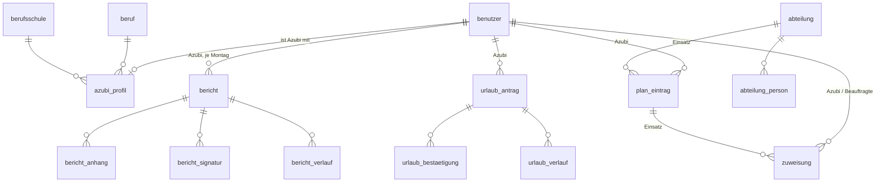

# Spezifikation Ausbildungsportal

Stand: Version 0.70.0 · 14.11.2026

Diese Datei beschreibt in einem Dokument, **was** das Portal kann (Funktionen), **womit** es arbeitet (Datenmodell) und **wo** man es bedient (Screens). Einzelheiten stehen an anderer Stelle:

| Thema | Wo |
| --- | --- |
| Bedienung je Rolle | Handbuch im Portal (`src/pages/Handbuch.tsx`) |
| Rechte jeder Route | `server/rechte.ts`, Rechte-Tabelle in `server/test/api.test.ts` |
| Bedienregeln, Gestaltung | `docs/bedienregeln.md`, `docs/gestaltung.md` |
| Barrierefreiheit, Sicherheit | `docs/barrierefreiheit.md`, `docs/sicherheit-owasp.md` |
| Betrieb, Docker, Entra | `README.md`, `SECURITY.md`, `docs/entra-einrichtung.md` |
| Bildschirmfotos | `docs/bilder/` |

## 1. Überblick

Eine Installation gehört zu **einem** Ausbildungsbetrieb. Das Portal führt Ausbildungsplan, Berichtsheft (Ausbildungsnachweis nach § 13 BBiG) und Urlaub der Azubis und bietet ein freiwilliges Lernmodul.

| Rolle | Anmeldung | Kurz |
| --- | --- | --- |
| Azubi | Microsoft Entra ID | eigener Plan, eigene Berichte, Urlaub, Lernmodul |
| Ausbildungsbeauftragte | Microsoft Entra ID | zugewiesene Azubis im Zeitraum: abzeichnen, Aufgaben, Urlaub bestätigen |
| Ausbilder | Microsoft Entra ID | zuständige Azubis: planen, abzeichnen, Urlaub genehmigen, Stammdaten, Konten |
| Super-Admin | lokal mit Passwort | Konten, Protokoll, Fehlermeldungen, Lerninhalte übernehmen – **kein** Zugriff auf Plan, Berichte, Urlaub |

**Technik:** Node.js ab 22.16 mit `node:http` und `node:sqlite` (kein Server-Framework), React 19 mit eigenem Router, ein Stylesheet, esbuild. Betrieb als Docker-Container hinter einem Reverse Proxy. Daten in einer SQLite-Datei in `DATA_DIR`, Lerninhalte als Ordner in `LERN_DIR`.

## 2. Funktionen

### Anmeldung und Konten

- Anmeldung über Microsoft Entra ID (OpenID Connect mit PKCE, `state`, `nonce`); Zugang nur mit vorher angelegtem Konto. Rollen kommen aus dem Portal, nicht aus Entra.
- Super-Admin lokal unter `/super`: Passwort mindestens 14 Zeichen, nach fünf Fehlversuchen 15 Minuten Pause.
- Sitzung: Ende nach 8 Stunden ohne Anfrage, spätestens nach 24 Stunden; fünf Minuten vorher eine Warnung mit „Angemeldet bleiben“. Wer mit ungespeicherten Eingaben abgemeldet wird, meldet sich im neuen Tab an und speichert danach.
- Konten anlegen, ändern, sperren, löschen: Ausbilder für Azubis und Beauftragte, Super-Admin für alle. Gesamtsicht für einzelne Ausbilder (alle Azubis). Letzte Anmeldung sieht nur der Super-Admin.
- Konto-Seite: Unterschrift zeichnen oder aus dem Namen erzeugen, Profilbild aus Microsoft 365 (wenn eingeschaltet), Darstellung hell/dunkel, Hinweis auf neue Versionen, Benachrichtigungen, Kalender-Abo, eigene Ausbildungsdaten.

### Ausbildungsplan

- Je Azubi eine Zeitleiste nach Kalenderwochen: Schulblöcke, Einsätze in Abteilungen, Aufgaben (mit Unteraufgaben, abhakbar), Notizen, private Termine des Azubis, Prüfungstermine, Firmentermine, Ferien und Feiertage.
- Einsatz in einer Abteilung weist deren Beauftragte und Stellvertretung für die Dauer automatisch zu.
- **Planbausteine:** Vorlagen je Beruf. **Sammelplanung:** ein Eintrag oder Baustein für mehrere Azubis auf einmal.
- **Jahreskalender:** ein Jahr auf einer Seite (Azubi: Tag für Tag; Betreuende: Azubis als Zeilen), nur zum Lesen; mit Lesemodus.

### Berichtsheft

- Ein Bericht je Woche (Wochen- oder Tagesform, vom Betrieb festgelegt): betriebliche Tätigkeiten, Unterweisungen, Berufsschule, je mit Stunden; Abwesenheit mit Urlaub, Feiertag oder „Abwesend“ (ohne Grund). Feiertage und genehmigter Urlaub sind vorbelegt.
- Fotos und Dateien anhängen (Bilder, PDF, Office ohne Makros; 5 MB je Datei, 12 je Bericht; Typ am Dateianfang geprüft).
- Ablauf: Entwurf (nur Azubi) → eingereicht (mit Unterschrift) → abgezeichnet (mit Unterschrift) oder zurückgegeben mit Kommentar; Abzeichnung kann ein Ausbilder mit Begründung aufheben. Jeder Schritt steht im Verlauf des Berichts.
- Ausgabe als PDF (einzeln oder alle) und als Druckansicht.
- **Abzeichnen:** Liste aller Berichte, die auf die eigene Unterschrift warten.

### Urlaub

- Antrag des Azubis (Zeitraum, freiwillige Bemerkung) → Bestätigung durch alle im Zeitraum zugewiesenen Beauftragten → Genehmigung durch den zuständigen Ausbilder. Ablehnen und Stornieren nur mit Begründung.
- Arbeitstage ohne Feiertage, Urlaubskonto je Kalenderjahr, Warnungen bei Berufsschule, Prüfung oder zu wenig Resttagen.
- Nach Genehmigung und Storno eine Mail an die Personalstelle (ohne Bemerkung, ohne Begründung).

### Lernmodul (freiwillig, privat)

- Inhaltspakete je Beruf (Markdown in `LERN_DIR`): Themenfelder, Unterthemen, Kompendium, Karteikarten, Quiz, Zusatzwissen. Ein Paket „für alle Berufe“ lesen alle Azubis unter `/anleitungen`, ohne Lernstand.
- Lernstand je Unterthema (Ampel, Lernpunkte, Notizen), Abzeichen je Themenfeld mit Rang, Üben mit Karteikarten (Fächer) und Quiz.
- **Planer für die Prüfung** (z. B. Abschlussprojekt), je Azubi freigeschaltet; nur seine Termine erscheinen im Plan.
- Ausbilder reichen neue Lerninhalte als ZIP ein; der Super-Admin prüft und übernimmt oder gibt zurück. Ausbilder und Beauftragte lesen die Inhalte, nie den Lernstand.

### Begleiter (freiwillig, privat)

- Selbst gezeichnete Figur mit Namen; Zubehör verteilt sich über die Ausbildungszeit. Erinnert höchstens einmal am Tag an Anstehendes (Bericht, Unterschrift, Berufsschule, Firmentermin, Prüfung, Urlaub) – nie ans Lernen. Schalter für das ganze Portal beim Super-Admin.

### Glocke, Benachrichtigungen, Kalender

- **Glocke:** neue Einträge, eingereichte, abgezeichnete und zurückgegebene Berichte, Urlaubsschritte, Freischaltung des Planers, aktualisierte Lerninhalte; Löschung nach 60 Tagen.
- **Benachrichtigungen** per Teams und E-Mail, je Bereich selbst einschaltbar; nennen nur die Empfängerin, keine Inhalte.
- **Kalender-Abo:** ein geheimer Link (iCal) mit Schule, Einsätzen, Prüfungen, genehmigtem Urlaub, privaten Terminen.

### Rückmeldung geben

- Drei Arten: **Fehler** (nur Super-Admin liest; freiwillig mit Bildschirmfoto), **Idee fürs Portal** (Super-Admin bearbeitet, Ausbilder lesen), **Wunsch zu Lerninhalten** (nur Azubis; ohne Person gespeichert, nur Ausbilder lesen).

### Verwaltung und Betrieb

- **Stammdaten** (Ausbilder): Betrieb, Bundesland, Berichtsform, Berufe, Berufsschulen, Abteilungen mit Personen, Firmentermine, Mail an die Personalstelle, Lernmodul je Beruf, Paket für alle Berufe.
- **Erscheinungsbild** (Super-Admin): Logo hell und dunkel, Begleiter-Schalter.
- **Protokoll** (Super-Admin): Anmeldungen und Änderungen an Konten, Zuweisungen, Stammdaten, Profilen; Löschung nach 90 Tagen.
- **Sicherung:** täglich (sieben bleiben), vor jeder Migration und auf Befehl (je zehn bleiben).
- **Ansicht:** „Volle Breite“ in der Kopfzeile auf jeder Seite (ab 1300 px, im Browser gemerkt); Lesemodus im Lernthema, im Handbuch und im Jahreskalender (dort ohne schmalere Seite); Seitenleiste „Inhalt“ einklappbar.
- **Hilfe:** Handbuch je Rolle mit Suche und Lesemodus, Führung beim ersten Anmelden, Versionshinweise, Hinweis auf neue Versionen.

## 3. Datenmodell

SQLite, 39 Tabellen, Migrationen fortlaufend in `server/migrations/` (Stand: 034). Zeitangaben als ISO-Text, Wochen über ihren **Montag** (`YYYY-MM-DD`). JSON-Felder sind als Text gespeichert.

### Kern

### Konten und Anmeldung

| Tabelle | Inhalt | Schlüssel und Bezüge |
| --- | --- | --- |
| `benutzer` | Anmeldeweg, Anmeldename, Entra-Objekt-ID, Anzeigename, Rolle, Passwort-Hash (nur Super-Admin), Status, Fehlversuche, Sperre bis, Farbschema, letzte Anmeldung, Gesamtsicht, Profilbild an/aus, Versionshinweis an/aus | `id` |
| `sitzung` | Hash des Sitzungs-Tokens, Beginn, letzte Anfrage, Ablauf | `token_hash` → `benutzer` |
| `anmeldevorgang` | laufende Entra-Anmeldung (`state`, `nonce`, `code_verifier`) | `state` |
| `unterschrift` | eigene Unterschrift als SVG-Pfad | `benutzer_id` |
| `benutzer_bild` | Profilbild aus Microsoft 365 (96 × 96) | `benutzer_id` |
| `kalender_abo` | geheimer Abo-Link, letzter Abruf | `benutzer_id` |
| `benachrichtigung_wahl` | Teams/Mail je Bereich | `benutzer_id`, `bereich` |
| `benachrichtigung_warte` | noch zu versendende Benachrichtigungen | → `benutzer`, `aktivitaet` |

### Ausbildung

| Tabelle | Inhalt | Schlüssel und Bezüge |
| --- | --- | --- |
| `azubi_profil` | Beruf, Berufsschule, zuständiger Ausbilder, Beginn, Vertragsende, Verkürzung, vorzeitige Zulassung, Wochenstunden, Prüfungen (JSON), Urlaubstage, Berichtsform, Planer frei | `benutzer_id` → `beruf`, `berufsschule`, `benutzer` |
| `beruf` | Bezeichnung, Fachrichtung, Regeldauer, Lernpaket | `id` |
| `berufsschule` | Name, Ort, Bundesland, Form (Block oder Teilzeit) | `id` |
| `abteilung`, `abteilung_person` | Abteilungen mit Beauftragten und Stellvertretung | `abteilung_id`, `benutzer_id` |
| `zuweisung` | Azubi ↔ Beauftragte oder Vertretung mit Zeitraum; aus einem Einsatz oder von Hand | `id` → `benutzer`, `plan_eintrag` |
| `plan_eintrag` | Art (Schule, Einsatz, Aufgabe, Notiz, privater Termin), Zeitraum, Titel, Text, Zuständige, erledigt, Unteraufgaben (JSON), Abteilung, Sammelplanung | `id` → `benutzer`, `abteilung`, `sammelplanung` |
| `planvorlage` | Planbaustein je Beruf, Einträge als JSON | `id` → `beruf` |
| `sammelplanung` | eine Sammelplanung: Azubis und Einträge (JSON) | `id` |
| `firmentermin` | Termin für alle, Zeitraum, Hinweis | `id` |

### Berichtsheft

| Tabelle | Inhalt | Schlüssel und Bezüge |
| --- | --- | --- |
| `bericht` | Status, Inhalt (JSON: Form, Zeilen je Abschnitt, Abwesenheit), Kommentar, Zeitpunkte, abgezeichnet von | `azubi_id`, `montag` |
| `bericht_anhang` | Datei mit Name, Typ, Größe, Tag, Daten | `id` → `bericht` |
| `bericht_signatur` | Kopie der Unterschrift beim Einreichen und Abzeichnen, mit Name, Rolle, Zeit | `id` → `bericht` |
| `bericht_verlauf` | jeder Schritt mit Name, Rolle, Kommentar | `id` → `bericht` |

### Urlaub

| Tabelle | Inhalt | Schlüssel und Bezüge |
| --- | --- | --- |
| `urlaub_antrag` | Zeitraum, Arbeitstage, Bemerkung, Status, Stand der Mail an die Personalstelle | `id` → `benutzer` |
| `urlaub_bestaetigung` | wer bestätigt hat und wann | `antrag_id`, `benutzer_id` |
| `urlaub_verlauf` | jeder Schritt mit Name, Rolle, Begründung | `id` → `urlaub_antrag` |

### Lernmodul und Begleiter – privat für den Azubi

| Tabelle | Inhalt | Schlüssel |
| --- | --- | --- |
| `lern_status` | Ampel, Lernpunkte, Notiz je Unterthema | `azubi_id`, `paket`, `unterthema_id` |
| `lern_abzeichen` | höchste Stufe je Themenfeld | `azubi_id`, `paket`, `feld_id` |
| `lern_karte` | Fach und Fälligkeit je Karteikarte | `azubi_id`, `paket`, `karte_id` |
| `lern_quiz` | Versuche, letztes Ergebnis, bestanden, fehlerfrei | `azubi_id`, `paket`, `unterthema_id` |
| `lern_zusatz` | gelesenes Zusatzwissen | `azubi_id`, `paket`, `zusatz_id` |
| `planer` | Vorhaben, Termine, Haken, Phasen, Antworten, Notizen (JSON) | `azubi_id`, `paket` |
| `begleiter` | Figur, Name, an/aus, gezeigte Stufe, abgeschaltete Erinnerungen | `azubi_id` |

Dazu, nicht privat: `lern_paket_stand` (Prüfsumme je Unterthema, für „Lerninhalte aktualisiert“) und `lern_einreichung` (eingereichte ZIP-Dateien mit Prüfergebnis und Entscheidung).

### Querschnitt

| Tabelle | Inhalt |
| --- | --- |
| `aktivitaet` | Einträge der Glocke: Zeit, Azubi, wer, Art, Woche, Titel; Löschung nach 60 Tagen |
| `protokoll` | Zeit, Bereich, Aktion, wer, betroffen, Angabe; Löschung nach 90 Tagen |
| `fehlermeldung` | Rückmeldungen aller drei Arten (`art`); bei Wünschen zu Lerninhalten ohne Person |
| `einstellungen` | Schlüssel/Wert: Betrieb, Bundesland, Berichtsform, Logos, Personalstelle, Schalter |
| `schema_version` | Stand der Migrationen |

## 4. Screens

Pfade des eigenen Routers (`src/App.tsx`). Navigation: ab 1024 px Kopfzeile mit Gruppen, darunter Leiste unten mit „Mehr“. Rechts in der Kopfzeile auf jeder Seite: „Volle Breite“ (ab 1300 px), „Rückmeldung geben“, Glocke, Menü am Namen.

### Alle Rollen

| Pfad | Seite | Inhalt |
| --- | --- | --- |
| `/anmelden`, `/super` | Anmelden | Microsoft-Anmeldung; `/super` lokal für den Super-Admin |
| `/konto` | Konto | Unterschrift, Profilbild, Darstellung, Benachrichtigungen, Kalender-Abo, Ausbildungsdaten |
| `/handbuch` | Handbuch | Kapitel je Rolle, Suche, Lesemodus, Führung neu starten |
| `/versionen` | Versionshinweise | Änderungen je Version |
| (Kopfzeile) | Glocke, Rückmeldung geben | Fenster über der Seite |

### Azubi

| Pfad | Seite | Inhalt |
| --- | --- | --- |
| `/` | Plan | eigener Ausbildungsplan (Startseite) |
| `/berichtsheft` | Berichtsheft | Wochen mit Stand, PDF |
| `/berichtsheft/<Montag>` | Bericht | Bericht schreiben, Anhänge, einreichen |
| `/berichtsheft/druck` | Druckansicht | alle Berichte zum Drucken |
| `/urlaub` | Urlaub | Anträge, Urlaubskonto |
| `/jahreskalender` | Jahreskalender | eigenes Jahr |
| `/lernen`, `/lernen/<Themenfeld>`, `/lernen/kompendium` | Lernen | Themenfelder, Lernstand, Abzeichen |
| `/lernen/ueben`, `…/karten/<Feld>`, `…/quiz/<Unterthema>` | Üben | Karteikarten, Quiz |
| `/planer` | Planer | Planer für die Prüfung (wenn freigeschaltet) |
| `/anleitungen`, `/anleitungen/<Thema>` | Anleitungen | Paket für alle Berufe, nur lesen |

### Ausbilder und Beauftragte

| Pfad | Seite | Inhalt |
| --- | --- | --- |
| `/` | Start | Kacheln: wartende Berichte, wartende Urlaubsanträge, Zahl der Azubis; darunter die Azubis |
| `/azubis` | Azubis | Karten der betreuten Azubis |
| `/azubis/<id>` | Profil | Ausbildungsdaten, Prüfungen, Zuweisungen, Planer-Freischaltung |
| `/azubis/<id>/plan`, `…/berichtsheft[/<Montag>]`, `…/urlaub` | Plan, Berichtsheft, Urlaub | wie beim Azubi, mit Reitern je Azubi |
| `/abzeichnen` | Abzeichnen | wartende Berichte |
| `/urlaub` | Urlaub | Anträge zum Bestätigen oder Genehmigen |
| `/jahreskalender`, `/jahreskalender/<id>` | Jahreskalender | alle betreuten Azubis bzw. einer |
| `/lerninhalte`, `/lerninhalte/<Paket>[/…]` | Lerninhalte | Lehrmaterial lesen (ohne Lernstand); Ausbilder reichen neue Pakete ein |

### Nur Ausbilder

| Pfad | Seite | Inhalt |
| --- | --- | --- |
| `/planung/sammelplanung` | Sammelplanung | Eintrag oder Baustein für mehrere Azubis |
| `/planung/bausteine` | Planbausteine | Vorlagen je Beruf |
| `/verwaltung/stammdaten` | Stammdaten | Betrieb, Berufe, Schulen, Abteilungen, Firmentermine, Personalstelle, Lernmodul |
| `/verwaltung/konten` | Konten | Azubis und Beauftragte verwalten |
| `/rueckmeldungen` | Rückmeldungen | Ideen und Wünsche zu Lerninhalten |

### Nur Super-Admin

| Pfad | Seite | Inhalt |
| --- | --- | --- |
| `/verwaltung/konten` | Konten | alle Konten, letzte Anmeldung, Gesamtsicht |
| `/verwaltung/protokoll` | Protokoll | die neuesten 200 Einträge |
| `/verwaltung/meldungen` | Rückmeldungen | Fehler und Ideen |
| `/verwaltung/lerninhalte` | Lerninhalte | Einreichungen prüfen, übernehmen, zurückgeben |
| `/verwaltung/erscheinungsbild` | Erscheinungsbild | Logo, Begleiter-Schalter |

## 5. Schnittstelle

Alle Routen liegen unter `/api/` und sind in `server/api.ts` und den Fachmodulen als `{ m, p, wer, h }` erklärt: Methode, Pfad, erlaubte Rollen, Funktion. 145 Routen, die meisten unter `/api/azubis/:id/…` (Plan, Berichte, Urlaub, Profil, Zuweisungen). Fremde Kennung → 404, falsche Rolle → 403; schreibende Anfragen prüfen die Herkunft (`Origin`). Die vollständige Liste mit Rechten steht in `server/test/api.test.ts`.

| Bereich | Präfix |
| --- | --- |
| Anmeldung | `/api/auth/…` |
| eigenes Konto | `/api/ich/…` |
| Azubi-bezogen | `/api/azubis/:id/…` |
| Urlaub | `/api/urlaub/…` |
| Lernmodul, Planer, Begleiter | `/api/lernen/…`, `/api/planer/…`, `/api/begleiter/…`, `/api/anleitungen/…` |
| Verwaltung | `/api/konten/…`, `/api/stammdaten/…`, `/api/abteilungen/…`, `/api/planvorlagen/…`, `/api/protokoll`, `/api/branding/…`, `/api/lernpakete/…`, `/api/lerninhalte/…` |
| Rückmeldungen | `/api/fehlermeldungen/…`, `/api/rueckmeldungen/…` |
| Sonstiges | `/api/aktivitaeten/…` (Glocke), `/api/jahreskalender`, `/api/abo/…` (Kalender), `/api/health` |

## 6. Grundsätze

- **Datenschutz:** Lernstand, Abzeichen, Übungsergebnisse, Planer (außer Terminen), Begleiter, private Termine und Entwürfe sind privat für den Azubi. Wünsche zu Lerninhalten ohne Person. Benachrichtigungen ohne fremde Namen und Inhalte. Kein Abwesenheitsgrund mit Gesundheitsbezug.
- **Keine Leistungs- und Verhaltenskontrolle:** keine Noten, Ranglisten, Statistiken oder Vergleiche zwischen Azubis.
- **Barrierefreiheit:** WCAG 2.2 AA; PC, Tablet und Handy ab 320 px.
- **Sicherheit:** OWASP Top 10:2025; Container gehärtet; Pakete fest über `package-lock.json`.
