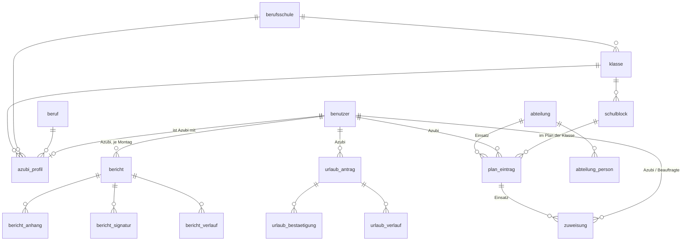

# Spezifikation Ausbildungsportal

Stand: Version 0.85.1 · 25.11.2026

Diese Datei beschreibt in einem Dokument, **was** das Portal kann (Funktionen), **womit** es arbeitet (Datenmodell) und **wo** man es bedient (Screens). Einzelheiten stehen an anderer Stelle:

| Thema | Wo |
| --- | --- |
| Bedienung je Rolle | Handbuch im Portal (`src/pages/Handbuch.tsx`) |
| Rechte jeder Route | `server/rechte.ts`, Rechte-Tabelle in `server/test/api.test.ts` |
| Bedienregeln, Gestaltung | `docs/bedienregeln.md`, `docs/gestaltung.md` |
| Barrierefreiheit, Sicherheit | `docs/barrierefreiheit.md`, `docs/sicherheit-owasp.md` |
| Betrieb, Docker, Entra | `README.md`, `SECURITY.md`, `docs/entra-einrichtung.md` |
| Bildschirmfotos | `docs/bilder/` |

## 1. Überblick

Eine Installation gehört zu **einem** Ausbildungsbetrieb. Das Portal führt Ausbildungsplan, Berichtsheft (Ausbildungsnachweis nach § 13 BBiG) und Urlaub der Azubis und bietet ein freiwilliges Lernmodul.

| Rolle | Anmeldung | Kurz |
| --- | --- | --- |
| Azubi | Microsoft Entra ID | eigener Plan, eigene Berichte, Urlaub, Lernmodul |
| Ausbildungsbeauftragte | Microsoft Entra ID | zugewiesene Azubis im Zeitraum: abzeichnen, Aufgaben, Urlaub bestätigen |
| Ausbilder | Microsoft Entra ID | zuständige Azubis: planen, abzeichnen, Urlaub genehmigen, Stammdaten, Konten |
| Super-Admin | lokal mit Passwort | Konten, Protokoll, Fehlermeldungen, Lerninhalte übernehmen – **kein** Zugriff auf Plan, Berichte, Urlaub |

**Technik:** Node.js ab 26 mit `node:http` und `node:sqlite` (kein Server-Framework), React 19 mit eigenem Router, ein Stylesheet, esbuild. Betrieb als Docker-Container hinter einem Reverse Proxy. Daten in einer SQLite-Datei in `DATA_DIR`, Lerninhalte als Ordner in `LERN_DIR`.

## 2. Funktionen

### Anmeldung und Konten

- Anmeldung über Microsoft Entra ID (OpenID Connect mit PKCE, `state`, `nonce`); Zugang nur mit vorher angelegtem Konto. Rollen kommen aus dem Portal, nicht aus Entra.
- Super-Admin lokal unter `/super`: Passwort mindestens 14 Zeichen, nach fünf Fehlversuchen 15 Minuten Pause.
- Sitzung: Ende nach 8 Stunden ohne Anfrage, spätestens nach 24 Stunden; fünf Minuten vorher eine Warnung mit „Angemeldet bleiben“. Wer mit ungespeicherten Eingaben abgemeldet wird, meldet sich im neuen Tab an und speichert danach.
- Angemeldete Geräte (unter „Konto“, jede Rolle): die eigenen Sitzungen mit Browser und System, Beginn und letzter Anfrage; andere Geräte einzeln oder alle auf einmal abmelden. Niemand sieht die Geräte anderer.
- Konten anlegen, ändern, sperren, löschen: Ausbilder für Azubis und Beauftragte, Super-Admin für alle. Gesamtsicht für einzelne Ausbilder (alle Azubis). Letzte Anmeldung sieht nur der Super-Admin.
- Konto-Seite: Unterschrift zeichnen oder aus dem Namen erzeugen, Profilbild aus Microsoft 365 (wenn eingeschaltet), Darstellung hell/dunkel, Hinweis auf neue Versionen, Benachrichtigungen, Kalender-Abo, eigene Ausbildungsdaten.

### Ausbildungsplan

- Je Azubi eine Zeitleiste nach Kalenderwochen: Schulblöcke, Einsätze in Abteilungen, Aufgaben (mit Unteraufgaben, abhakbar), Notizen, private Termine des Azubis, Prüfungstermine, Firmentermine, Ferien und Feiertage.
- Einsatz in einer Abteilung weist deren Beauftragte und Stellvertretung für die Dauer automatisch zu.
- **Planbausteine:** Vorlagen je Beruf. **Sammelplanung:** ein Eintrag oder Baustein für mehrere Azubis auf einmal.
- **Klassen und Schulblöcke:** Ein Azubi gehört zu einer Klasse seiner Berufsschule (die ganze Ausbildung). Schulblöcke pflegen Ausbilder einmal an der Klasse; sie stehen im Plan jedes Azubis der Klasse und ändern sich mit. Im Plan einzeln geändert oder gelöscht, folgt ein Block dort der Klasse nicht mehr. Neue und geänderte Blöcke stehen in der Glocke.
- **Plan der Schule einlesen:** PDF hochladen (liest der Dienst „import“: Text, Texterkennung bei Scans, Vorschlag eines lokalen Sprachmodells) oder Text einfügen (das Portal sucht selbst nach Zeiträumen). Nur angelegte Klassen der Schule (auch dem Sprachmodell vorgegeben); Aufbau „Klasse zuerst“, „Block zuerst, darunter die Klassen“ oder Tabelle (Spalte je Block, Klassenzeilen darunter; Zuordnung über die Spalte im Text von `pdftotext -layout`, Titel aus der Kopfzeile und dem Thema unter der Klasse). Vorschau mit Prüfung (schon vorhanden, Überschneidung mit einem Block der Klasse – wahlweise ersetzen –, eigene Einträge „Berufsschule“ ohne Klasse bei Azubis der Klasse – wahlweise entfernen –, Ferien, genehmigter Urlaub); übernommen wird nur Angehaktes. Aufträge liegen in `data/import/<id>/` und werden nach dem Übernehmen, spätestens nach 24 Stunden gelöscht.
- **Einsatzwünsche:** Der Azubi wünscht sich einen Einsatz in einer Abteilung aus den Stammdaten (ganze Wochen, höchstens 26, freiwilliger Grund). Entscheiden kann nur, wer den Azubi verwaltet (Ausbilder): genehmigen – auch mit angepasstem Zeitraum – legt einen Einsatz mit Abteilung im Plan an (ohne den Grund), ablehnen nur mit Begründung. Hinweise bei Überschneidung mit Schulblock, Einsatz oder Urlaub. Ausbildungsbeauftragte sehen Wünsche nicht, auch nicht in der Glocke.
- **Erinnerungen:** Beauftragte und Ausbilder setzen sich private Erinnerungen zu Azubis, die sie sehen (Beauftragte auch schon vor einer künftigen Zuweisung, dann nur zu deren Einsätzen) – vor einem Einsatz (Tage vorher; wandert mit, wenn der Einsatz verschoben wird) oder an einem festen Tag. Fällige stehen in der eigenen Glocke (einmal je Tag), per Teams und E-Mail ohne Inhalt. Sieht die Person den Azubi nicht mehr, löst sich die Erinnerung vom Einsatz. Erledigte werden nach 90 Tagen gelöscht.
- **Zeitleiste (nur Ausbilder):** Reiter je Azubi mit der ganzen Ausbildung als Wasserfall (Einsätze, Schulblöcke, genehmigter Urlaub, Prüfungen), Linie für heute, Zoom bis auf ein Quartal; ein Klick öffnet die Woche im Plan (`…/plan#kw-<Montag>`). Nur Ansicht aus vorhandenen Daten.
- **Jahreskalender:** ein Jahr auf einer Seite (Azubi: Tag für Tag; Betreuende: Azubis als Zeilen), nur zum Lesen; mit Lesemodus.

### Berichtsheft

- Ein Bericht je Woche (Wochen- oder Tagesform, vom Betrieb festgelegt, je Azubi abweichend). In der Tagesform Montag bis Freitag; Samstag und Sonntag schaltet der Ausbilder je Azubi im Profil frei (ohne Freischaltung lehnt der Server neue Einträge am Wochenende ab, schon gespeicherte bleiben; Soll je Tag weiter Wochenstunden ÷ 5): betriebliche Tätigkeiten, Unterweisungen, Berufsschule, je mit Stunden; Abwesenheit mit Urlaub, Feiertag oder „Abwesend“ (ohne Grund). Feiertage und genehmigter Urlaub sind vorbelegt.
- **Speichern von selbst:** Der Bericht speichert 2 s nach der letzten Eingabe, vor einem Wochenwechsel, vor dem Einreichen und beim Verlassen der Seite (`keepalive`); ein leerer neuer Bericht wird nicht angelegt. Bei Verbindungsfehlern neuer Versuch nach 15 s; erst dann fragt das Portal beim Verlassen nach. Kein eigener Speichern-Knopf.
- **Zwischen Wochen blättern:** vorherige und nächste Woche mit Stand (`nachbarn` in der Antwort), begrenzt auf die Ausbildungszeit. Schreiben geht bis eine Woche im Voraus (`VORAUS_WOCHEN`, sonst 400), einreichen erst ab dem Montag der Woche (`kommend`, sonst 409).
- Fotos und Dateien anhängen (Bilder, PDF, Office ohne Makros; 5 MB je Datei, 12 je Bericht; Typ am Dateianfang geprüft).
- Ablauf: Entwurf (nur Azubi) → eingereicht (mit Unterschrift) → abgezeichnet (mit Unterschrift) oder zurückgegeben mit Kommentar; Abzeichnung kann ein Ausbilder mit Begründung aufheben. Jeder Schritt steht im Verlauf des Berichts.
- Ausgabe als PDF (einzeln oder alle) und als Druckansicht.
- **Azubi wechseln:** Auf den Seiten eines Azubis (Profil, Plan, Berichtsheft, Bericht, Urlaub, Zeitleiste) wechseln Ausbilder und Beauftragte zum vorherigen oder nächsten Azubi ihrer Liste oder wählen einen aus; die Seite bleibt dieselbe.
- **Abzeichnen:** Liste aller Berichte, die auf die eigene Unterschrift warten; eingelesene Berichte sind markiert.
- **Alte Berichte einlesen** (nur der Azubi): PDF hochladen (Dienst „import“: Text, Texterkennung bei Scans, einzelne Seiten, Vorschlag des Sprachmodells) oder Text einfügen. Das Portal erkennt Wochen (Zeitraum, „Woche vom …“, KW mit Jahr), die drei Teile, Tage und Stunden selbst – auch Exporte digitaler Berichtshefte mit einem Kasten je Tag (Kopf „Mo | 05.01.2026 | Ort | anwesend  08:00“ oder „MO 05.01.2026“ mit dem Ort in der nächsten Zeile): ein Eintrag je Tag mit den Stunden des Tages, bei Stunden je Abschnitt („[2:30]“, Trenner „—“) ein Eintrag je Abschnitt; in Tagesform zählt nur, was unter einem Tag steht; das Sprachmodell ergänzt nur. Übernommen werden angehakte Wochen ohne Bericht (oder mit leerem Entwurf, der ersetzt wird) als Entwurf, mit Vermerk `eingelesen` im Verlauf und – bei einer PDF – der Originalseite als Anhang. Zeilen zu Krankheit fallen weg. Eingelesene Entwürfe lassen sich gesammelt einreichen (mit Unterschrift). Aufträge wie beim Plan der Schule in `data/import/<id>/`, nur für den Azubi selbst.

### Urlaub

- Antrag des Azubis (Zeitraum, freiwillige Bemerkung) → Bestätigung durch alle im Zeitraum zugewiesenen Beauftragten → Genehmigung durch den zuständigen Ausbilder. Ablehnen und Stornieren nur mit Begründung.
- Arbeitstage ohne Feiertage, Urlaubskonto je Kalenderjahr, Warnungen bei Berufsschule, Prüfung oder zu wenig Resttagen.
- Nach Genehmigung und Storno eine Mail an die Personalstelle (ohne Bemerkung, ohne Begründung).

### Lernmodul (freiwillig, privat)

- Inhaltspakete je Beruf (Markdown in `LERN_DIR`): Themenfelder, Unterthemen, Kompendium, Karteikarten, Quiz, Zusatzwissen. Ein Paket „für alle Berufe“ lesen alle Azubis unter `/anleitungen`, ohne Lernstand.
- Lernstand je Unterthema (Ampel, Lernpunkte, Notizen), Abzeichen je Themenfeld mit Rang, Üben mit Karteikarten (Fächer) und Quiz.
- Geänderte Inhalte: Glocke für die Azubis des Berufs; im Unterthema der Hinweis „Inhalt aktualisiert“ und die Marken „neu“ bzw. „geändert“ an den Stellen, die sich seit dem letzten Blick geändert haben (nur für Azubis, die das Unterthema schon bewertet haben).
- **Planer für die Prüfung** (z. B. Abschlussprojekt), je Azubi freigeschaltet; nur seine Termine erscheinen im Plan.
- Ausbilder reichen neue Lerninhalte als ZIP ein; der Super-Admin prüft und übernimmt oder gibt zurück. Ausbilder und Beauftragte lesen die Inhalte, nie den Lernstand.

### Begleiter (freiwillig, privat)

- Selbst gezeichnete Figur mit Namen; Zubehör verteilt sich über die Ausbildungszeit. Erinnert höchstens einmal am Tag an Anstehendes (Bericht, Unterschrift, Berufsschule, Firmentermin, Prüfung, Urlaub) – nie ans Lernen. Schalter für das ganze Portal beim Super-Admin.

### Glocke, Benachrichtigungen, Kalender

- **Glocke:** neue Einträge, geänderte Schulblöcke, eingereichte, abgezeichnete und zurückgegebene Berichte, Urlaubsschritte, Einsatzwünsche (nicht für Beauftragte), fällige eigene Erinnerungen, Freischaltung des Planers, aktualisierte Lerninhalte, Rückfragen zu eigenen Rückmeldungen; Löschung nach 60 Tagen.
- **Benachrichtigungen** per Teams und E-Mail, je Bereich (Berichtsheft, Urlaub, Ausbildungsplan, Rückmeldungen) selbst einschaltbar; ohne fremde Namen, ohne Inhalte. Teams über die Teams-App „Ausbildungsportal“ (Aktivitätsfeed über Microsoft Graph, Anwendungsberechtigung `TeamsActivity.Send`, Empfänger ist die Entra-Objekt-ID); ein Klick zeigt im Bereich „Aktivität“ einen Hinweis mit „In der App öffnen“. **In der App läuft das Portal**, angemeldet über Teams (Single Sign-on: Token von Teams, geprüft in `server/teams-sso.ts`; eigene Sitzung mit Cookie `ap_teams`, SameSite=None, partitioniert). In Teams entfällt der zusätzliche Rand für die Gestensteuerung unten (Klasse `in-teams`), weil Teams ihn selbst freihält.
- **Kalender-Abo:** ein geheimer Link (iCal) mit Schule, Einsätzen, Prüfungen, genehmigtem Urlaub, privaten Terminen.

### Rückmeldung geben

- Drei Arten: **Fehler** (nur Super-Admin liest; freiwillig mit Bildschirmfoto), **Idee fürs Portal** (Super-Admin bearbeitet, Ausbilder lesen), **Wunsch zu Lerninhalten** (nur Azubis; ohne Person gespeichert, nur Ausbilder lesen).
- **Rückfragen:** Zu Fehlern schreibt der Super-Admin, zu Ideen auch die Ausbilder der meldenden Person zurück; sie bekommt einen Eintrag in der Glocke (persönlich, nur für sie) und antwortet unter „Meine Meldungen“. Eine Antwort öffnet eine erledigte Meldung wieder und geht – wenn eingerichtet – als Karte an den Teams-Kanal für Rückmeldungen (ohne Namen, Text nur mit `FEHLER_WEBHOOK_MIT_TEXT`), weil der Super-Admin keine Glocke hat. Wünsche zu Lerninhalten haben kein Gespräch.

### Verwaltung und Betrieb

- **Stammdaten** (Ausbilder): Betrieb, Bundesland, Berichtsform, Berufe, Berufsschulen, Abteilungen mit Personen, Firmentermine, Mail an die Personalstelle, Lernmodul je Beruf, Paket für alle Berufe.
- **Erscheinungsbild** (Super-Admin): Logo hell und dunkel, Begleiter-Schalter, Teams-App (Stand, App-ID ändern, App-Paket zum Herunterladen – die Version steigt von selbst, wenn sich der Inhalt ändert –, ein- und ausschalten; mit `TEAMS_APP_ID` in der `.env` übernommen und gesperrt).
- **Protokoll** (Super-Admin): Anmeldungen und Änderungen an Konten, Zuweisungen, Stammdaten, Profilen; Löschung nach 90 Tagen.
- **Sicherung:** täglich (sieben bleiben), vor jeder Migration und auf Befehl (je zehn bleiben).
- **Ansicht:** „Volle Breite“ in der Kopfzeile auf jeder Seite (ab 1300 px, im Browser gemerkt); Lesemodus im Lernthema, im Handbuch und im Jahreskalender (dort ohne schmalere Seite); Seitenleiste „Inhalt“ einklappbar.
- **Hilfe:** Handbuch je Rolle mit Suche und Lesemodus, Führung beim ersten Anmelden, Versionshinweise, Hinweis auf neue Versionen.

## 3. Datenmodell

SQLite, 46 Tabellen, Migrationen fortlaufend in `server/migrations/` (Stand: 040). Zeitangaben als ISO-Text, Wochen über ihren **Montag** (`YYYY-MM-DD`). JSON-Felder sind als Text gespeichert.

### Kern

### Konten und Anmeldung

| Tabelle | Inhalt | Schlüssel und Bezüge |
| --- | --- | --- |
| `benutzer` | Anmeldeweg, Anmeldename, Entra-Objekt-ID, Anzeigename, Rolle, Passwort-Hash (nur Super-Admin), Status, Fehlversuche, Sperre bis, Farbschema, letzte Anmeldung, Gesamtsicht, Profilbild an/aus, Versionshinweis an/aus | `id` |
| `sitzung` | Hash des Sitzungs-Tokens, Beginn, letzte Anfrage, Ablauf, Gerät (nur Browser und System, z. B. „Safari · iPhone“; keine IP-Adresse) | `token_hash` → `benutzer` |
| `anmeldevorgang` | laufende Entra-Anmeldung (`state`, `nonce`, `code_verifier`) | `state` |
| `unterschrift` | eigene Unterschrift als SVG-Pfad | `benutzer_id` |
| `benutzer_bild` | Profilbild aus Microsoft 365 (96 × 96) | `benutzer_id` |
| `kalender_abo` | geheimer Abo-Link, letzter Abruf | `benutzer_id` |
| `benachrichtigung_wahl` | Teams/Mail je Bereich | `benutzer_id`, `bereich` |
| `benachrichtigung_warte` | noch zu versendende Benachrichtigungen | → `benutzer`, `aktivitaet` |

### Ausbildung

| Tabelle | Inhalt | Schlüssel und Bezüge |
| --- | --- | --- |
| `azubi_profil` | Beruf, Berufsschule, Klasse, zuständiger Ausbilder, Beginn, Vertragsende, Verkürzung, vorzeitige Zulassung, Wochenstunden, Prüfungen (JSON), Urlaubstage, Berichtsform, Planer frei, Wochenende im Berichtsheft (Tagesform) | `benutzer_id` → `beruf`, `berufsschule`, `klasse`, `benutzer` |
| `beruf` | Bezeichnung, Fachrichtung, Regeldauer, Lernpaket | `id` |
| `berufsschule` | Name, Ort, Bundesland, Form (Block oder Teilzeit) | `id` |
| `klasse` | Klasse an der Berufsschule: Name (je Schule einmalig), Beruf (freiwillig) | `id` → `berufsschule`, `beruf` |
| `schulblock` | Schulblock einer Klasse: Zeitraum (Wochen), Titel, Text, geändert von | `id` → `klasse` |
| `schulblock_ausnahme` | Block wurde im Plan eines Azubis einzeln geändert oder gelöscht – folgt der Klasse dort nicht mehr | `schulblock_id`, `azubi_id` |
| `abteilung`, `abteilung_person` | Abteilungen mit Beauftragten und Stellvertretung | `abteilung_id`, `benutzer_id` |
| `zuweisung` | Azubi ↔ Beauftragte oder Vertretung mit Zeitraum; aus einem Einsatz oder von Hand | `id` → `benutzer`, `plan_eintrag` |
| `plan_eintrag` | Art (Schule, Einsatz, Aufgabe, Notiz, privater Termin), Zeitraum, Titel, Text, Zuständige, erledigt, Unteraufgaben (JSON), Abteilung, Sammelplanung, Schulblock der Klasse | `id` → `benutzer`, `abteilung`, `sammelplanung`, `schulblock` |
| `planungswunsch` | Einsatzwunsch des Azubis: Abteilung (mit Namen beim Wünschen), Zeitraum (Wochen), Grund, Status (offen, genehmigt, abgelehnt, zurückgezogen), Entscheidung mit Name und Begründung, angelegter Einsatz | `id` → `benutzer`, `abteilung`, `plan_eintrag` |
| `erinnerung` | private Erinnerung von Beauftragten oder Ausbildern: Azubi, Text, Tag (fest oder Einsatz minus Tage vorher), erledigt, zuletzt gemeldet | `id` → `benutzer` (Person und Azubi), `plan_eintrag` |
| `planvorlage` | Planbaustein je Beruf, Einträge als JSON | `id` → `beruf` |
| `sammelplanung` | eine Sammelplanung: Azubis und Einträge (JSON) | `id` |
| `firmentermin` | Termin für alle, Zeitraum, Hinweis | `id` |

### Berichtsheft

| Tabelle | Inhalt | Schlüssel und Bezüge |
| --- | --- | --- |
| `bericht` | Status, Inhalt (JSON: Form, Zeilen je Abschnitt, Abwesenheit), Kommentar, Zeitpunkte, abgezeichnet von | `azubi_id`, `montag` |
| `bericht_anhang` | Datei mit Name, Typ, Größe, Tag, Daten | `id` → `bericht` |
| `bericht_signatur` | Kopie der Unterschrift beim Einreichen und Abzeichnen, mit Name, Rolle, Zeit | `id` → `bericht` |
| `bericht_verlauf` | jeder Schritt mit Name, Rolle, Kommentar (auch `eingelesen`) | `id` → `bericht` |

### Urlaub

| Tabelle | Inhalt | Schlüssel und Bezüge |
| --- | --- | --- |
| `urlaub_antrag` | Zeitraum, Arbeitstage, Bemerkung, Status, Stand der Mail an die Personalstelle | `id` → `benutzer` |
| `urlaub_bestaetigung` | wer bestätigt hat und wann | `antrag_id`, `benutzer_id` |
| `urlaub_verlauf` | jeder Schritt mit Name, Rolle, Begründung | `id` → `urlaub_antrag` |

### Lernmodul und Begleiter – privat für den Azubi

| Tabelle | Inhalt | Schlüssel |
| --- | --- | --- |
| `lern_status` | Ampel, Lernpunkte, Notiz je Unterthema | `azubi_id`, `paket`, `unterthema_id` |
| `lern_abzeichen` | höchste Stufe je Themenfeld | `azubi_id`, `paket`, `feld_id` |
| `lern_karte` | Fach und Fälligkeit je Karteikarte | `azubi_id`, `paket`, `karte_id` |
| `lern_quiz` | Versuche, letztes Ergebnis, bestanden, fehlerfrei | `azubi_id`, `paket`, `unterthema_id` |
| `lern_zusatz` | gelesenes Zusatzwissen | `azubi_id`, `paket`, `zusatz_id` |
| `planer` | Vorhaben, Termine, Haken, Phasen, Antworten, Notizen (JSON) | `azubi_id`, `paket` |
| `begleiter` | Figur, Name, an/aus, gezeigte Stufe, abgeschaltete Erinnerungen | `azubi_id` |

Dazu, nicht privat: `lern_paket_stand` (Prüfsumme je Unterthema, für „Lerninhalte aktualisiert“), `lern_inhalt_version` (Prüfsummen der Bausteine je Inhaltsstand eines Unterthemas – damit der Azubi sieht, was seit seinem letzten Blick neu ist oder sich geändert hat; aufgehoben, solange der Stand aktuell ist oder ein Lernstand auf ihn verweist) und `lern_einreichung` (eingereichte ZIP-Dateien mit Prüfergebnis und Entscheidung).

### Querschnitt

| Tabelle | Inhalt |
| --- | --- |
| `aktivitaet` | Einträge der Glocke: Zeit, Azubi, wer, Art, Woche, Titel; Löschung nach 60 Tagen. Bei persönlichen Arten (aktualisierte Lerninhalte, Rückfragen) steht in `azubi_id` die Person, für die der Eintrag ist – nur sie sieht ihn |
| `protokoll` | Zeit, Bereich, Aktion, wer, betroffen, Angabe; Löschung nach 90 Tagen |
| `fehlermeldung` | Rückmeldungen aller drei Arten (`art`); bei Wünschen zu Lerninhalten ohne Person. Löschung 30 Tage nach „erledigt“ (`erledigt_am`), samt Gespräch und Bild. `antwort_neu`: die Person hat zuletzt geschrieben; `person_gesehen`: bis zu welcher Nachricht sie gelesen hat |
| `fehlermeldung_nachricht` | Gespräch zu einem Fehler oder einer Idee: Zeit, wer (Konto, Name, Rolle), Text; wird mit der Meldung gelöscht |
| `einstellungen` | Schlüssel/Wert: Betrieb, Bundesland, Berichtsform, Logos, Personalstelle, Schalter, App-ID, Schalter und Stand des Pakets der Teams-App (`teams_app_id`, `teams_aktiv`, `teams_paket`) |
| `schema_version` | Stand der Migrationen |

## 4. Screens

Pfade des eigenen Routers (`src/App.tsx`). Navigation: ab 1024 px Kopfzeile mit Gruppen, darunter Leiste unten mit „Mehr“. Rechts in der Kopfzeile auf jeder Seite: „Volle Breite“ (ab 1300 px), „Rückmeldung geben“, Glocke, Menü am Namen.

### Alle Rollen

| Pfad | Seite | Inhalt |
| --- | --- | --- |
| `/anmelden`, `/super` | Anmelden | Microsoft-Anmeldung; `/super` lokal für den Super-Admin |
| `/konto` | Konto | Unterschrift, Profilbild, Darstellung, Benachrichtigungen, Kalender-Abo, Ausbildungsdaten, angemeldete Geräte |
| `/handbuch` | Handbuch | Kapitel je Rolle, Suche, Lesemodus, Führung neu starten |
| `/versionen` | Versionshinweise | Änderungen je Version |
| `/meine-meldungen` | Meine Meldungen | eigene Fehler und Ideen mit Gespräch; im Menü, sobald man etwas gemeldet hat |
| (Kopfzeile) | Glocke, Rückmeldung geben | Fenster über der Seite |

### Azubi

| Pfad | Seite | Inhalt |
| --- | --- | --- |
| `/` | Plan | eigener Ausbildungsplan (Startseite) |
| `/berichtsheft` | Berichtsheft | Wochen mit Stand, PDF |
| `/berichtsheft/<Montag>` | Bericht | Bericht schreiben, Anhänge, einreichen |
| `/berichtsheft/druck` | Druckansicht | alle Berichte zum Drucken |
| `/berichtsheft/einlesen` | Alte Berichte einlesen | PDF oder Text, Vorschau, als Entwurf übernehmen, gesammelt einreichen |
| `/urlaub` | Urlaub | Anträge, Urlaubskonto |
| `/einsatzwuensche` | Einsatz wünschen | Wunsch stellen, eigene Wünsche mit Stand, zurückziehen (aus dem Plan erreichbar) |
| `/jahreskalender` | Jahreskalender | eigenes Jahr |
| `/lernen`, `/lernen/<Themenfeld>`, `/lernen/kompendium` | Lernen | Themenfelder, Lernstand, Abzeichen |
| `/lernen/ueben`, `…/karten/<Feld>`, `…/quiz/<Unterthema>` | Üben | Karteikarten, Quiz |
| `/planer` | Planer | Planer für die Prüfung (wenn freigeschaltet) |
| `/anleitungen`, `/anleitungen/<Thema>` | Anleitungen | Paket für alle Berufe, nur lesen |

### Ausbilder und Beauftragte

| Pfad | Seite | Inhalt |
| --- | --- | --- |
| `/` | Start | Kacheln: wartende Berichte, wartende Urlaubsanträge, Zahl der Azubis; darunter die Azubis |
| `/azubis` | Azubis | Karten der betreuten Azubis |
| `/azubis/<id>` | Profil | Ausbildungsdaten, Prüfungen, Zuweisungen, Planer-Freischaltung |
| `/azubis/<id>/plan`, `…/berichtsheft[/<Montag>]`, `…/urlaub` | Plan, Berichtsheft, Urlaub | wie beim Azubi, mit Reitern je Azubi |
| `/abzeichnen` | Abzeichnen | wartende Berichte |
| `/urlaub` | Urlaub | Anträge zum Bestätigen oder Genehmigen |
| `/jahreskalender`, `/jahreskalender/<id>` | Jahreskalender | alle betreuten Azubis bzw. einer |
| `/erinnerungen` | Erinnerungen | eigene, private Erinnerungen zu Azubis (Beauftragte im Hauptmenü, Ausbilder unter „Planung“) |
| `/lerninhalte`, `/lerninhalte/<Paket>[/…]` | Lerninhalte | Lehrmaterial lesen (ohne Lernstand); Ausbilder reichen neue Pakete ein |

### Nur Ausbilder

| Pfad | Seite | Inhalt |
| --- | --- | --- |
| `/azubis/<id>/zeitleiste` | Zeitleiste | Reiter je Azubi: ganze Ausbildung als Wasserfall, Zoom |
| `/planung/einsatzwuensche` | Einsatzwünsche | offene Wünsche genehmigen oder ablehnen, Entscheidungen der letzten 90 Tage |
| `/planung/sammelplanung` | Sammelplanung | Eintrag oder Baustein für mehrere Azubis |
| `/planung/schulbloecke` | Schulblöcke | Schulblöcke je Klasse; stehen im Plan aller Azubis der Klasse |
| `/planung/schulbloecke/einlesen` | Plan der Schule einlesen | PDF oder Text, Vorschau, übernehmen |
| `/planung/bausteine` | Planbausteine | Vorlagen je Beruf |
| `/verwaltung/stammdaten` | Stammdaten | Betrieb, Berufe, Schulen mit Klassen, Abteilungen, Firmentermine, Personalstelle, Lernmodul |
| `/verwaltung/konten` | Konten | Azubis und Beauftragte verwalten |
| `/rueckmeldungen` | Rückmeldungen | Ideen (mit Rückfrage) und Wünsche zu Lerninhalten |

### Nur Super-Admin

| Pfad | Seite | Inhalt |
| --- | --- | --- |
| `/verwaltung/konten` | Konten | alle Konten, letzte Anmeldung, Gesamtsicht |
| `/verwaltung/protokoll` | Protokoll | die neuesten 200 Einträge |
| `/verwaltung/meldungen` | Rückmeldungen | Fehler und Ideen, mit Rückfrage |
| `/verwaltung/lerninhalte` | Lerninhalte | Einreichungen prüfen, übernehmen, zurückgeben |
| `/verwaltung/erscheinungsbild` | Erscheinungsbild | Logo, Begleiter-Schalter, Teams-App |

## 5. Schnittstelle

Alle Routen liegen unter `/api/` und sind in `server/api.ts` und den Fachmodulen als `{ m, p, wer, h }` erklärt: Methode, Pfad, erlaubte Rollen, Funktion. 186 Routen, die meisten unter `/api/azubis/:id/…` (Plan, Berichte, Urlaub, Profil, Zuweisungen). Fremde Kennung → 404, falsche Rolle → 403; schreibende Anfragen prüfen die Herkunft (`Origin`). Die vollständige Liste mit Rechten steht in `server/test/api.test.ts`.

| Bereich | Präfix |
| --- | --- |
| Anmeldung | `/api/auth/…` |
| eigenes Konto | `/api/ich/…` |
| Azubi-bezogen | `/api/azubis/:id/…` |
| Urlaub | `/api/urlaub/…` |
| Einsatzwünsche, Erinnerungen | `/api/azubis/:id/wuensche`, `/api/wuensche/…`, `/api/erinnerungen/…` |
| Lernmodul, Planer, Begleiter | `/api/lernen/…`, `/api/planer/…`, `/api/begleiter/…`, `/api/anleitungen/…` |
| Verwaltung | `/api/konten/…`, `/api/stammdaten/…`, `/api/abteilungen/…`, `/api/planvorlagen/…`, `/api/protokoll`, `/api/branding/…`, `/api/teams/…`, `/api/schulbloecke/…`, `/api/lernpakete/…`, `/api/lerninhalte/…` |
| Rückmeldungen | `/api/fehlermeldungen/…`, `/api/rueckmeldungen/…`, `/api/meine-meldungen/…` |
| Sonstiges | `/api/aktivitaeten/…` (Glocke), `/api/jahreskalender`, `/api/abo/…` (Kalender), `/api/health` |

Außerhalb von `/api/` liefert der Server neben der Oberfläche nur `/teams/app`: den Einstieg der Teams-App – ohne Daten; meldet über Teams an (`POST /api/auth/teams`) und öffnet dann das Ziel. Mit eingeschalteter Teams-App darf das Portal in Teams und Microsoft 365 eingebettet werden, sonst nirgends.

## 6. Grundsätze

- **Datenschutz:** Lernstand, Abzeichen, Übungsergebnisse, Planer (außer Terminen), Begleiter, private Termine und Entwürfe sind privat für den Azubi. Wünsche zu Lerninhalten ohne Person. Benachrichtigungen ohne fremde Namen und Inhalte. Kein Abwesenheitsgrund mit Gesundheitsbezug.
- **Keine Leistungs- und Verhaltenskontrolle:** keine Noten, Ranglisten, Statistiken oder Vergleiche zwischen Azubis.
- **Barrierefreiheit:** WCAG 2.2 AA; PC, Tablet und Handy ab 320 px.
- **Sicherheit:** OWASP Top 10:2025; Container gehärtet; Pakete fest über `package-lock.json`.
